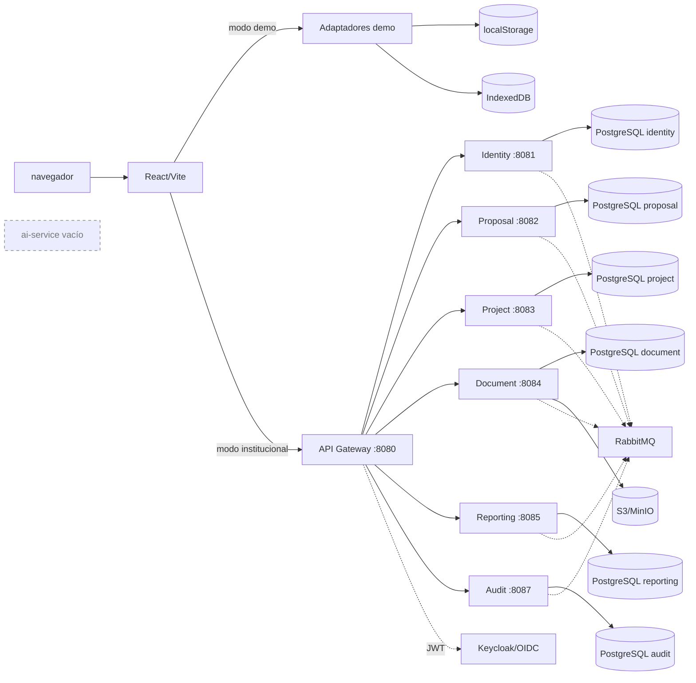
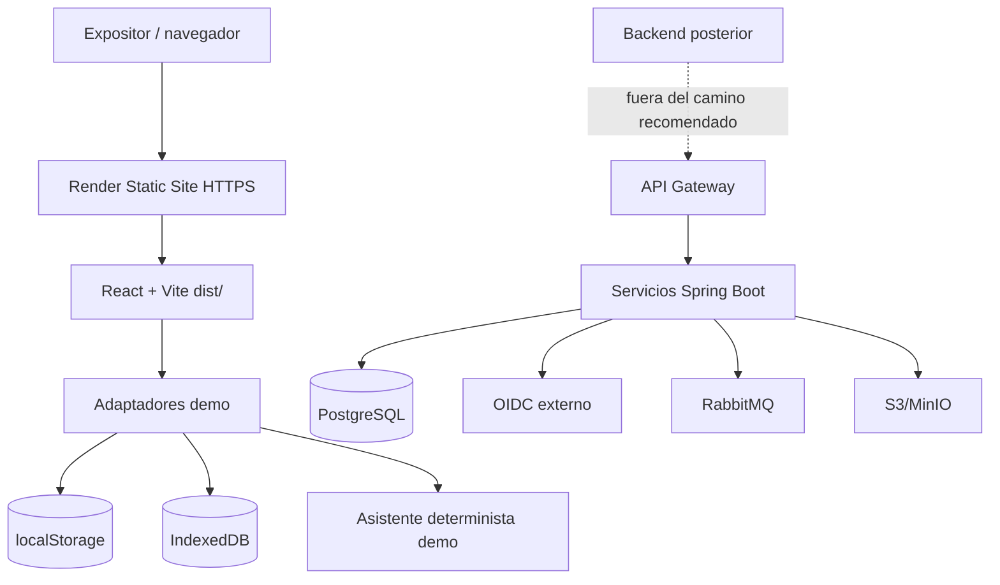

# Análisis de despliegue de InvestiTrack AI en Render Free

Este análisis conserva la evaluación previa a la integración local. El [README raíz](./README.md) describe el Compose y el estado actual. La validación de este cambio se realiza en Docker local.

**Fecha del análisis:** 2026-11-25  
**Alcance:** auditoría estática del checkout actual. No se modificaron archivos de aplicación, no se instalaron dependencias y no se realizó ningún despliegue. El único archivo generado/actualizado por esta tarea es este informe.

## 1. Resumen ejecutivo

El checkout actual sí contiene una arquitectura backend distribuida. Los componentes verificados son:

- Frontend React/Vite en `front/`, con modo demo autocontenido y transporte HTTP institucional.
- Siete aplicaciones Java/Spring Boot desplegables: `API-gateway`, `identity-service`, `proposal-service`, `project-service`, `document-service`, `report-service` y `audit-service`.
- Un proyecto legado/esqueleto `Backend/InvestiTrackBack`, que no debe contarse como octavo microservicio funcional.
- Keycloak definido para desarrollo local en `Backend/keycloak`.
- Configuración de RabbitMQ en varios servicios y uso de almacenamiento S3-compatible/MinIO por `document-service`.
- Ninguna implementación de backend en `ai-service`: la carpeta no contiene archivos. La IA visible hoy es el adaptador demo del frontend.

**Conclusión:** publicar por $0 la experiencia de exposición es viable con un Render Static Site usando `VITE_DEMO_MODE=true`. Publicar la plataforma backend completa en Render Free no es razonable sin varios servicios adicionales, múltiples bases, un IdP accesible, RabbitMQ, almacenamiento de objetos y una implementación de IA que actualmente no existe. Además, siete procesos Java exceden el margen operativo prudente de un plan gratuito con memoria y horas compartidas.

Los rangos de RAM indicados son **estimaciones de planificación**, no mediciones. Las cuotas, caducidad, suspensión y límites exactos de Render Free deben verificarse en la documentación oficial antes de crear recursos.

## 2. Arquitectura real del proyecto

### Hechos verificados

| Área | Evidencia | Estado |
|---|---|---|
| UI | `front/package.json`, `front/src/` | Implementada |
| Demo | `front/src/demo/`, `front/src/api/assistant.api.ts`, `front/README.md:30` | Implementada en navegador |
| API edge | `Backend/API-gateway/src/`, `application.properties:1-35` | Implementada |
| Identidad | `Backend/identity-service/src/`, migraciones V1-V3 | Implementada; depende de OIDC |
| Propuestas | `Backend/proposal-service/src/`, migraciones V1-V6 | Implementada |
| Proyectos | `Backend/project-service/src/`, migraciones V1-V2 | Implementada |
| Documentos | `Backend/document-service/src/`, migración V1 | Implementada; requiere S3-compatible |
| Reporting | `Backend/report-service/src/`, migración V1 | Implementada |
| Auditoría | `Backend/audit-service/src/`, migración V1 | Implementada |
| IA backend | `ai-service/` vacío | No implementada |
| IdP | `Backend/keycloak/compose.yaml`, realm JSON | Definido para local |
| Persistencia demo | `localStorage`, IndexedDB y memoria | Solo navegador |
| CI/CD | No se encontraron workflows/pipelines | No implementado |

### Árbol simplificado

```text
InvestiTrack-AI/
├─ front/                         React 19 + TypeScript + Vite + Tailwind
│  ├─ src/api/                    Transporte institucional y demo
│  ├─ src/demo/                   Semillas, permisos, workflows y archivos locales
│  ├─ src/features/               Dashboard, propuestas, proyectos, documentos, IA, etc.
│  ├─ src/router/                 Rutas públicas y protegidas
│  ├─ package.json                Node >=22.12, build/test/lint
│  └─ .env.example                VITE_DEMO_MODE y VITE_API_URL
├─ Backend/
│  ├─ API-gateway/                Spring Cloud Gateway WebFlux, puerto 8080
│  ├─ identity-service/           Spring Boot Gradle, puerto 8081
│  ├─ proposal-service/           Spring Boot Maven/JPA, puerto 8082
│  ├─ project-service/            Spring Boot Maven/JDBC, puerto 8083
│  ├─ document-service/           Spring Boot Maven/JDBC/S3, puerto 8084
│  ├─ report-service/             Spring Boot Maven/JDBC, puerto 8085
│  ├─ audit-service/              Spring Boot Maven/JDBC, puerto 8087
│  ├─ keycloak/                   Realm y Compose local, puerto 8180 externo
│  ├─ InvestiTrackBack/           Artefactos de un esqueleto Gradle antiguo
│  └─ .agents/                    Arquitectura, contratos y esquema objetivo
├─ ai-service/                    Carpeta vacía; sin runtime ni dependencias
├─ docs/                          Progreso y documentación del frontend
└─ ANALISIS_DEPLOY_RENDER.md      Este informe
```

### Arquitectura documentada versus ejecutable

`Backend/.agents/backend-architecture.md` y `database-schema.md` describen una plataforma más amplia, incluyendo notificaciones, IA, embeddings y pgvector. Son diseño objetivo. Las migraciones ejecutables no crean tablas vectoriales ni extensiones pgvector y no existe un servicio de IA.



## 3. Frontend

### Hechos verificados

- React `^19.2.0`, React DOM `^19.2.0`, TypeScript `~5.9.3`, Vite `^7.1.12`, React Router `^7.9.4`, TanStack Query `^5.90.5`, React Hook Form `^7.65.0`, Zod `^4.1.12` y Tailwind `^4.1.16` (`front/package.json:16-45`).
- Node requerido: `>=22.12.0` (`front/package.json:48`).
- Instalación: `npm ci` (`front/README.md:8-12`).
- Compilación: `npm run build` = `tsc -b && vite build` (`front/package.json:6`). Salida: `front/dist`.
- Variables: `VITE_DEMO_MODE` y `VITE_API_URL` (`front/.env.example`, `front/src/lib/config.ts:1-5`). Las variables `VITE_*` son públicas en el bundle.
- Demo: `VITE_DEMO_MODE=true`; el asistente usa `demoAssistant` (`front/src/api/assistant.api.ts:16`); los datos usan `localStorage`, IndexedDB y memoria (`front/ARCHITECTURE.md:7-29`, `front/README.md:30`).
- Institucional: `VITE_DEMO_MODE=false` y `VITE_API_URL=/api` (`front/README.md:43-49`). El cliente HTTP usa `fetch` y credenciales de cookie (`front/src/api/http-client.ts:14-24`).
- Rutas: `createBrowserRouter` (`front/src/router/index.tsx:1-7`) con rutas protegidas. Render debe reescribir `/*` a `/index.html`.
- Compatibilidad Render Static Site: alta para demo; root `front`, build `npm ci && npm run build`, publish `front/dist`, Node 22.12+ y rewrite SPA.

### Dependencia con el backend

El frontend institucional espera rutas de identidad, proyectos, documentos, reporting, propuestas y asistente. El gateway enruta a esos servicios (`Backend/API-gateway/src/main/resources/application.properties:15-26`), pero la integración depende de JWT/OIDC, contratos, tokens de workload, CORS y URLs públicas. Activar `VITE_DEMO_MODE=false` no convierte la demo en una integración end-to-end.

### Cambios posteriores

Para el escenario C, ninguno en código: configurar Static Site, `VITE_DEMO_MODE=true` y fallback SPA. Para modo institucional: `VITE_API_URL` al gateway HTTPS, CORS, cookies, OIDC y servicios dependientes. No poner credenciales en `VITE_*`.

## 4. Inventario de servicios backend

La cantidad real es **siete aplicaciones backend**.

| Servicio | Responsabilidad y evidencia | Build/ejecución | Puerto | Health check | Dependencias |
|---|---|---|---:|---|---|
| `API-gateway` | Entrada pública, routing, límites y seguridad; `Backend/API-gateway/src/main/java/com/example/apigateway` | `./mvnw package`; `java -jar target/API-gateway-0.0.1-SNAPSHOT.jar` | 8080 vía `${PORT:8080}` | Actuator en management 9090 por defecto; revisar para Render | OIDC y seis downstream |
| `identity-service` | Usuarios, roles, autorización y bootstrap | `./gradlew bootJar`; `java -jar build/libs/*-SNAPSHOT.jar` | 8081 vía `${PORT:8081}` | `/actuator/health/liveness` | PostgreSQL, OIDC, RabbitMQ opcional, owners |
| `proposal-service` | Propuestas, evaluaciones, decisiones y outbox | `./mvnw package`; `java -jar target/proposal-service-0.0.1-SNAPSHOT.jar` | 8082 vía `${PORT:8082}` | `/actuator/health/liveness` | PostgreSQL, OIDC, Identity, Document, RabbitMQ |
| `project-service` | Proyectos, miembros, actividades y proyecciones | `./mvnw package`; `java -jar target/project-service-0.0.1-SNAPSHOT.jar` | 8083 vía `${PORT:8083}` | `/actuator/health/liveness` | PostgreSQL, OIDC, Identity/Proposal/Document, RabbitMQ |
| `document-service` | Metadatos, versiones, procesamiento y archivos | `./mvnw package`; `java -jar target/document-service-0.0.1-SNAPSHOT.jar` | 8084 vía `${PORT:8084}` | `/actuator/health/liveness` | PostgreSQL, OIDC, S3/MinIO, Project, RabbitMQ |
| `report-service` | Dashboards, proyecciones, reportes y exportaciones | `./mvnw package`; `java -jar target/report-service-0.0.1-SNAPSHOT.jar` | 8085 vía `${PORT:8085}` | `/actuator/health/liveness` | PostgreSQL, OIDC, Identity/Project/Proposal, RabbitMQ |
| `audit-service` | Ingesta, consulta, exportación y cadena de auditoría | `./mvnw package`; `java -jar target/audit-service-0.0.1-SNAPSHOT.jar` | 8087 vía `${PORT:8087}` | `/actuator/health/liveness` | PostgreSQL, OIDC, Identity, RabbitMQ opcional |

Todos tienen Dockerfile multi-stage con Maven/Gradle y Temurin 25, usuario no root y `EXPOSE` (`Backend/*/Dockerfile`). Los puertos ya aceptan `PORT`. El gateway separa management en 9090 y lo liga a `127.0.0.1` (`API-gateway/application.properties:31-35`); conviene usar el listener principal para el health check público.

### RAM y 512 MB

No se midió consumo. Como rango de planificación, un servicio Spring Boot 4/Java 25 con seguridad, JDBC y Actuator puede requerir aproximadamente 250–500 MB durante arranque y operación ligera; gateway reactivo y Document/Reporting pueden aumentar el pico. En 512 MB la compatibilidad es **incierta y de riesgo medio/alto por servicio**. La topología completa multiplica el consumo y no se recomienda para una exposición gratuita.

### Ejecución conjunta

Los `compose.yaml` por servicio crean PostgreSQL dedicada y usan la red Docker externa `investitrack`. Keycloak tiene su propio compose. No existe compose raíz que arranque toda la plataforma. En Render cada Web Service es independiente; ejecutar todo junto requeriría una consolidación nueva y perdería aislamiento. Mantener servicios separados es correcto técnicamente, pero no corresponde al objetivo mínimo.

## 5. Base de datos

- Motor: PostgreSQL con JDBC, Flyway y JDBC/JPA.
- Versión local declarada: PostgreSQL 16 en los compose; la versión administrada cloud no está fijada.
- Bases lógicas: `identity_db`, `proposal_db`, `project_db`, `document_db`, `reporting_db` y `audit_db`.
- Migraciones: Identity V1-V3; Proposal V1-V6; Project V1-V2; Document V1; Reporting V1; Audit V1.
- No se encontró `CREATE EXTENSION` ni `vector` en migraciones ejecutables. `pgvector` aparece solo en `Backend/.agents/database-schema.md` como diseño.
- Seeds/bootstrap: `proposal-service/http/seed-test-catalogs.sql` y variables `IDENTITY_BOOTSTRAP_*`; no existe un seeder común automático de producción.
- Una única instancia PostgreSQL podría alojar bases/schemas y usuarios separados si el proveedor lo permite. Eso conserva aislamiento lógico básico, pero no elimina la necesidad de seis configuraciones y límites de conexión.
- JPA/JDBC/Flyway son técnicamente compatibles con PostgreSQL administrado; deben verificarse cuotas, suspensión, retención, conexiones y tamaño.

### Inicialización propuesta

1. Crear PostgreSQL gratuita, si las condiciones vigentes soportan seis dominios lógicos.
2. Crear usuarios/credenciales separados por servicio.
3. Configurar `DATABASE_URL`, `DATABASE_USERNAME` y `DATABASE_PASSWORD` por Web Service.
4. Arrancar Identity y después los servicios dependientes; Flyway aplicará migraciones.
5. Ejecutar seeds/control de bootstrap y retirar variables temporales.
6. Ejecutar reconstrucciones de Reporting después de datos fuente y eventos.
7. Exportar datos demo antes de la exposición; la retención gratuita no debe tratarse como garantía.

## 6. Inteligencia artificial

`ai-service/` contiene cero archivos. No hay runtime Python/Java, SDK LLM, modelo local, embeddings, vector store, GPU, endpoint de IA ni Dockerfile. El frontend sí incluye `front/src/features/ai-assistant/` y `front/src/demo/assistant.ts`; es un asistente determinista demo con historial en memoria (`front/README.md:30`).

`Backend/.agents/backend-architecture.md` y `database-schema.md` mencionan AI indexing, embeddings y pgvector, pero son diseño objetivo. No permiten estimar RAM ni costos de un modelo real. Añadir IA real requeriría servicio, proveedor/modelo, ACL, extracción documental, embeddings, vector store, límites de costo y observabilidad.

**Recomendación:** conservar el asistente demo. No añadir una API gratuita ni una clave al frontend: sería una ampliación y expondría credenciales. Costos potenciales futuros: tokens, embeddings, almacenamiento, transferencia y cuotas del proveedor.

## 7. Servicios adicionales

| Componente | Evidencia | Demo frontend | Backend completo | Consecuencia si falta |
|---|---|---:|---:|---|
| RabbitMQ | Dependencias AMQP y propiedades; contratos en `.agents/service-contracts.md` | No | Sí para eventos/proyecciones cuando messaging está activo | Reporting, auditoría y sincronizaciones no reciben eventos |
| Kafka | No encontrado | No | No | Ninguna conocida |
| Redis | No encontrado | No | No | Ninguna conocida |
| MinIO/S3 | Cliente MinIO y `S3_*` en Document; no lo crea su compose | No | Sí para archivos | Fallan uploads/descargas/procesamiento |
| Keycloak/OIDC | `Backend/keycloak/compose.yaml`, realm y JWT en todos los servicios | No, login demo local | Sí | No hay emisión/validación real de tokens |
| API Gateway | Implementado en `Backend/API-gateway` | No | Sí como frontera pública | Se pierde routing, límites y CORS |
| Object storage externo | Interfaz S3 | No | Sí para Document | No hay persistencia institucional de archivos |
| Workers/jobs | `*Jobs.java`, `JOBS_ENABLED`, consumidores | No | Sí para limpieza/rebuild/exportación | Trabajos pendientes y proyecciones desactualizadas |
| Correo | Solo diseño documental; no servicio implementado | No | No demostrado como dependencia | No habría correo; demo no afectada |

Keycloak y MinIO están definidos para Docker/local, no como despliegues Render listos. RabbitMQ no está incluido en los compose individuales inspeccionados.

## 8. Docker, configuración y localhost

Existen Dockerfiles para gateway, Identity, Proposal, Project, Document, Reporting y Audit; `.dockerignore` para esos servicios; compose para Audit, Document, Project, Proposal, Reporting y Keycloak; y no hay compose raíz. Los compose crean PostgreSQL local con volúmenes Docker, que no equivalen a disco persistente gratuito en Render.

Los defaults de `application.properties` apuntan a `localhost`, hostnames Docker o puertos locales. En cloud deben reemplazarse por URLs públicas/secretos. No se encontraron workflows CI/CD. Los scripts son auxiliares, por ejemplo `Backend/scripts/init-docker-env.py` y generadores OpenAPI.

Adaptaciones posteriores: usar `PORT` (ya soportado), URLs HTTPS entre servicios, OIDC público, CORS exacto del Static Site, RabbitMQ/S3 accesibles, y health checks contra `/actuator/health/liveness`. Mantener `/internal/**`, Actuator detallado y OpenAPI protegidos; no publicar endpoints internos sin autenticación.

## 9. Compatibilidad con Render Free

| Restricción | Impacto concreto | Mitigación mínima |
|---|---|---|
| Memoria limitada | Siete JVM más gateway y bases pueden superar el margen gratuito | Publicar frontend demo; probar backend solo por fases y medir |
| Suspensión/cold start | Primer acceso, DB y OIDC pueden ser lentos | Calentar la demo antes de presentarla |
| Horas compartidas | Cada Web Service consume cuota | Evitar backend completo en la exposición |
| Sin disco persistente | Keycloak local, volúmenes y archivos temporales no son estrategia cloud | IndexedDB para demo; S3 externo para Document |
| PostgreSQL limitado/expirable | Se requieren seis dominios y migraciones | Una instancia con aislamiento solo si las cuotas lo soportan; seed reproducible |
| Red privada no asumible | Los hostnames Docker no existen automáticamente en cloud | URLs HTTPS o red soportada; mantener autenticación de servicio |
| Puertos | Servicios soportan `${PORT}`; gateway management usa otro puerto | Health check sobre listener público principal |
| OIDC externo | Todos validan JWT | IdP HTTPS gratuito/institucional, sujeto a límites |
| RabbitMQ ausente | Eventos y proyecciones se degradan | Broker externo o aceptar funcionalidad parcial explícita |
| S3 ausente | Document no maneja archivos reales | Object storage externo privado |
| HTTPS/CORS/cookies | Frontend debe llegar al gateway y OIDC validar issuer | URLs HTTPS, origen exacto y pruebas de navegador |

## 10. Seguridad y variables de entorno

| Variable | Servicio | Finalidad | Obligatoria cloud | Ejemplo ficticio |
|---|---|---|---:|---|
| `VITE_DEMO_MODE` | Frontend | Demo/institucional | Sí para C | `true` |
| `VITE_API_URL` | Frontend | Prefijo API | No en demo | `https://api-demo.example.invalid` |
| `PORT` | Todos | Puerto asignado | Sí, inyectada | `10000` |
| `DATABASE_URL` | Seis servicios | JDBC PostgreSQL | Sí | `jdbc:postgresql://db.invalid:5432/proposal_db` |
| `DATABASE_USERNAME` / `DATABASE_PASSWORD` | Seis servicios | Credenciales DB | Sí | `proposal_runtime` / `[REDACTED]` |
| `OIDC_ISSUER_URI` | Gateway/servicios | Issuer JWT | Sí backend | `https://idp.example.invalid/realms/demo` |
| `OIDC_JWK_SET_URI` | Gateway/servicios | JWKS | Sí si no hay discovery | `https://idp.example.invalid/.../certs` |
| `OIDC_AUDIENCE` | Gateway/servicios | Audiencia pública | Sí | `research-platform-api` |
| `OIDC_INTERNAL_AUDIENCE` | Servicios | Audiencia workload | Sí | `proposal-service` |
| `*_SERVICE_URL` | Gateway/servicios | URLs downstream/owners | Según dependencia | `https://service.example.invalid` |
| `*_SERVICE_TOKEN` | Servicios | Tokens workload | Según integración | `[REDACTED]` |
| `RABBITMQ_HOST`, `RABBITMQ_PORT` | Servicios AMQP | Broker | Si messaging activo | `broker.example.invalid`, `5672` |
| `RABBITMQ_USERNAME`, `RABBITMQ_PASSWORD` | Servicios AMQP | Credenciales broker | Si messaging activo | `proposal`, `[REDACTED]` |
| `S3_ENDPOINT`, `S3_PUBLIC_ENDPOINT` | Document | Endpoints S3 | Si archivos | `https://object.example.invalid` |
| `S3_REGION`, `S3_BUCKET` | Document | Región/bucket | Si archivos | `us-east-1`, `investitrack-demo` |
| `S3_ACCESS_KEY`, `S3_SECRET_KEY` | Document | Credenciales S3 | Si archivos | `[REDACTED]` |
| `CORS_ALLOWED_ORIGINS` | Gateway | Origen frontend | Sí | `https://demo.example.invalid` |
| `MAX_REQUEST_BYTES`, `MAX_UPLOAD_BYTES` | Gateway/Document | Límites payload | Opcional | `10485760`, `52428800` |
| `MESSAGING_ENABLED`, `JOBS_ENABLED` | Servicios | Eventos/workers | Según capacidades | `false` / `true` |
| `IDENTITY_BOOTSTRAP_*` | Identity | Admin inicial | Temporal | `admin@example.invalid` |
| `KC_BOOTSTRAP_ADMIN_*` | Keycloak local | Admin Keycloak | Local | `[REDACTED]` |

Se encontró `Backend/project-service/.env` con configuración local y una contraseña de reemplazo. El valor no se reproduce, pero debe revisarse antes de publicar y rotarse si alguna vez fue real. Los `.env.example`, `.env.docker.example` y archivos HTTP tampoco deben recibir secretos reales.

## 11. Estrategias de alojamiento

### A. Todos los componentes en Render Free

**Distribución:** Static Site, gateway, seis Web Services Java, PostgreSQL y servicios externos para Keycloak, RabbitMQ y S3 cuando Render no los cubra.

**Compatibilidad:** baja para $0; siete JVM, múltiples bases, OIDC, broker y object storage hacen improbable una exposición estable.  
**Ventajas:** URLs HTTPS y despliegue separado.  
**Desventajas:** RAM, horas, cold starts y superficie de fallo.  
**Cambios:** URLs, secretos, CORS, OIDC, broker, S3 y health checks.  
**Costos/riesgos:** cualquier exceso o tercero puede cobrar o expirar.  
**Afectación:** sin broker no hay proyecciones/eventos; sin S3 no hay documentos; sin IA no hay asistente real.

### B. Render Free + externos gratuitos

**Distribución:** frontend y servicios seleccionados en Render; OIDC, RabbitMQ y S3 externos; PostgreSQL gratuito administrado.

**Compatibilidad:** media para demo institucional limitada, condicionada por cada tercero.  
**Ventajas:** cubre dependencias que Render no provisiona.  
**Desventajas:** más cuentas, secretos, CORS, latencia y puntos de fallo.  
**Cambios:** configuración P1 y prueba end-to-end.  
**Riesgos:** cuotas variables, suspensión, egress y pérdida de datos demo.  
**Afectación:** IA real sigue ausente y correo/notificaciones no están implementados.

### C. Versión mínima funcional — recomendada

**Distribución:** un Render Static Site construido desde `front`, `VITE_DEMO_MODE=true`, fallback SPA y datos ficticios locales.

**Compatibilidad:** alta.  
**Ventajas:** menor superficie operativa; conserva dashboard, roles demo, propuestas, proyectos, actividades, evidencias, archivos locales y asistente determinista.  
**Desventajas:** sin colaboración, sincronización entre dispositivos, autenticación real, persistencia central ni IA real.  
**Cambios:** solo configuración de hosting.  
**Costo:** $0 nominal sujeto al plan vigente.  
**Riesgos:** cold start y pérdida de datos si se limpia el navegador.  
**Presentación:** rotular como demostración con datos simulados.

## 12. Problemas y bloqueos detectados

1. `ai-service` está vacío; no existe IA desplegable.
2. El modo institucional requiere siete aplicaciones, bases, OIDC, RabbitMQ y S3.
3. Keycloak está definido para Docker/local y usa hostname localhost.
4. Los servicios requieren URLs y tokens de workload; arrancar los JAR no basta.
5. No existe compose raíz ni manifiesto Render/IaC completo.
6. pgvector y notificaciones están en diseño, no en servicios/migraciones ejecutables.
7. `Backend/project-service/.env` debe revisarse y excluirse de publicación si contiene valores reales.
8. RabbitMQ y S3 no están provisionados por los compose individuales.
9. `InvestiTrackBack` no debe desplegarse como segundo backend: no aporta una API funcional.

## 13. Cambios necesarios por prioridad

### P0 — exposición $0

- Publicar solo `front` como Static Site.
- Usar `VITE_DEMO_MODE=true`.
- Build `npm ci && npm run build`, publish `dist` y rewrite `/*` a `/index.html`.
- Probar rutas directas, perfiles, evidencia, adjuntos IndexedDB y asistente demo.
- Etiquetar datos como simulados.

### P1 — backend parcial

- Revisar/rotar secretos y mantenerlos solo en el proveedor.
- Crear PostgreSQL y seis dominios lógicos aislados.
- Proporcionar OIDC HTTPS con claims/scopes compatibles.
- Probar primero Identity, Proposal, Project y Gateway; añadir Document/Report/Audit después de medir.
- Proporcionar RabbitMQ y S3 privado si se requieren eventos y archivos.
- Configurar URLs, CORS, workload tokens, Flyway, seeds y health checks.

### P2 — plataforma completa

- Implementar `ai-service` real con ACL, extracción, embeddings y vector store.
- Implementar/conectar notificaciones y correo.
- Formalizar DB, broker, object storage, observabilidad, backups y CI/CD.
- Verificar el esquema objetivo pgvector contra una implementación real.

## 14. Arquitectura de despliegue recomendada



La exposición no debe depender del backend. Si se aprueba una fase institucional, el frontend debe apuntar únicamente al gateway HTTPS y nunca a `/internal/**` directamente.

## 15. Estimación de costos

| Escenario | Costo base esperado | Costos/riesgos no incluidos |
|---|---:|---|
| C: Static Site demo | $0 nominal | Dominio opcional y cambios del plan gratuito |
| A: Todos los componentes | $0 nominal solo en teoría | Exceso de RAM/horas, DB, broker, S3, IdP, transferencia y terceros |
| B: Render + externos | $0 nominal dentro de tiers | Tokens IA, almacenamiento, transferencia, verificación, expiración y límites |

No son garantías comerciales. Deben verificarse precios, límites, regiones, retención, suspensión y egress de cada proveedor.

## 16. Archivos que deberán modificarse posteriormente

### Opción C

En principio ninguno de aplicación. Solo Render: root `front`, build `npm ci && npm run build`, publish `dist`, `VITE_DEMO_MODE=true` y rewrite SPA.

### Opciones A/B

- `front/src/lib/config.ts` o variables de build: URL HTTPS del gateway, sin secretos.
- `Backend/API-gateway/src/main/resources/application.properties`: origins, downstream, OIDC y management/health.
- `Backend/*/src/main/resources/application.properties`: DB, OIDC, tokens, RabbitMQ, S3 y flags.
- `Backend/*/Dockerfile`: revisar contexto y runtime, aunque ya existen.
- Nueva configuración Render/IaC y CI/CD.
- `Backend/keycloak/compose.yaml` y realm JSON: rediseñar hostname, persistencia y secretos para cloud.
- `Backend/project-service/.env`: retirar del flujo de publicación y rotar valores si alguno fue real.

## 17. Conclusión

**Viabilidad por $0:** sí, para una exposición académica usando el frontend demo como Static Site de Render. Es la opción que conserva más funcionalidades visibles con menor riesgo.

**Viabilidad de la aplicación completa:** técnicamente posible como arquitectura distribuida, pero no recomendable bajo Render Free y $0 sin una fase de integración considerable. El checkout requiere siete procesos backend, bases aisladas, OIDC, RabbitMQ y S3 para el modo institucional; la IA backend no existe. Los documentos `.agents` describen capacidades futuras que no deben presentarse como implementadas.

La estrategia recomendada es publicar primero C, documentar que los datos son simulados y tratar B como fase posterior con prueba de integración, revisión de secretos, validación de cuotas y revisión de seguridad. No se recomienda desactivar controles ni exponer endpoints internos.
