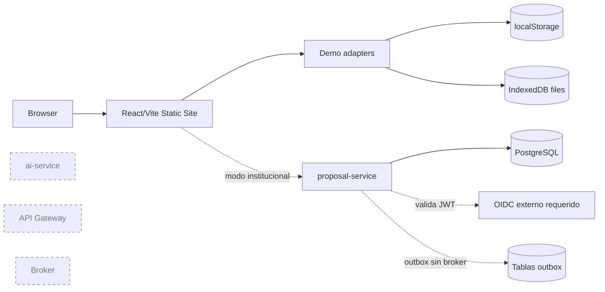
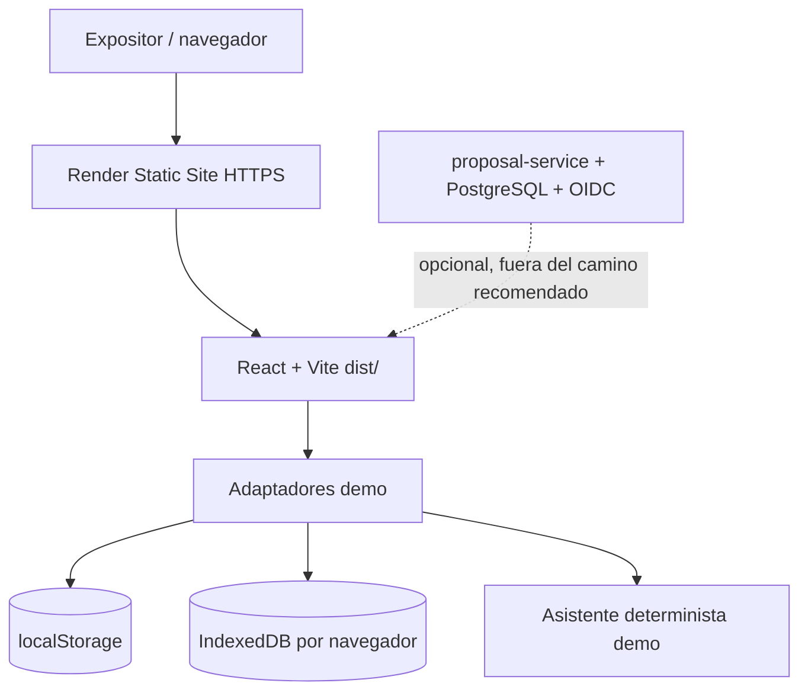

# Análisis de despliegue de InvestiTrack AI en Render Free

**Fecha del análisis:** 2026-11-25  
**Alcance:** auditoría estática del checkout actual. No se modificaron archivos existentes, no se instalaron dependencias y no se realizó ningún despliegue.

## 1. Resumen ejecutivo

El repositorio no contiene actualmente una plataforma completa de microservicios ni un módulo de IA desplegable. Lo verificado en código es:

- Un frontend React/Vite funcional con módulos de demostración, activables con `VITE_DEMO_MODE=true` ([front/.env.example](./front/.env.example), [front/src/lib/config.ts](./front/src/lib/config.ts:1)).
- Un único backend funcional identificable: `proposal-service`, Spring Boot/Maven, con API de propuestas, evaluaciones y catálogos, PostgreSQL, Flyway, JWT/OIDC y Actuator ([Backend/proposal-service/README.md](./Backend/proposal-service/README.md:1)).
- `Backend/InvestiTrackBack` es otro proyecto Spring Boot/Gradle mínimo, sin controladores, entidades ni migraciones propias; no debe contarse como segundo microservicio funcional ([Backend/InvestiTrackBack/src/main/java/com/example/investitrackback/InvestiTrackBackApplication.java](./Backend/InvestiTrackBack/src/main/java/com/example/investitrackback/InvestiTrackBackApplication.java:1)).
- `ai-service` existe como carpeta, pero no contiene archivos rastreados ni implementación ejecutable.
- No hay Dockerfile, Docker Compose, CI/CD, gateway, Keycloak, RabbitMQ, Kafka, Redis, MinIO, workers ni jobs implementados en el checkout.
- Las funcionalidades de proyectos, actividades, evidencias, documentos, reportes, administración y asistente están implementadas principalmente como simulación cliente: estado en `localStorage`, archivos en IndexedDB e historial de chat en memoria ([front/ARCHITECTURE.md](./front/ARCHITECTURE.md:1)).

**Conclusión:** sí es viable publicar por $0 una versión académica demostrable usando un Render Static Site con el frontend en modo demo. No es viable afirmar que se conserva toda la integración institucional y persistencia multiusuario con el repositorio actual sin agregar servicios y cambios relevantes. Desplegar el backend real en Render Free requiere además un PostgreSQL, un proveedor OIDC y configuración de variables/URLs; la aplicación no incluye un IdP.

Las cifras de RAM son rangos de planificación, no mediciones. Las cuotas y condiciones exactas de Render Free deben contrastarse con la documentación oficial vigente antes de crear recursos.

## 2. Arquitectura real del proyecto

### Hechos verificados

| Área | Implementación encontrada | Estado |
|---|---|---|
| UI | React 19 + TypeScript + Vite 7 + Tailwind 4 | Implementada |
| Transporte HTTP | `fetch`, TanStack Query, Zod; URL configurable | Implementado, pero el contrato completo no está conectado |
| Demo | Adaptadores locales por dominio, roles y políticas | Implementada y auto-contenida en navegador |
| Backend | Spring Boot 4.1.1, Java 21, Maven; `proposal-service` | Implementado |
| Backend adicional | Spring Boot 4.1.1, Java 21, Gradle; aplicación vacía | Esqueleto |
| PostgreSQL | JDBC + JPA + Flyway, 4 migraciones | Requerido solo por `proposal-service` |
| IA | Ningún servicio Python/Java, modelo, embedding o vector store | No implementada como servicio |
| Identidad | Backend valida JWT OIDC; frontend demo simula usuarios | IdP externo requerido para modo institucional |
| Eventos | Tablas outbox/processed en el servicio; no hay broker ni consumidor | Parcial, sin entrega externa |

### Árbol simplificado

```text
InvestiTrack-AI/
├─ front/                         React/Vite; demo y cliente HTTP institucional
│  ├─ src/api/                    Transporte y consultas
│  ├─ src/demo/                   Datos, permisos, workflows y archivos demo
│  ├─ src/features/               UI por dominio
│  ├─ src/router/                 Rutas públicas/protegidas
│  ├─ src/lib/config.ts           VITE_DEMO_MODE y VITE_API_URL
│  ├─ package.json                Node >=22.12, build Vite
│  └─ .env.example
├─ Backend/
│  ├─ proposal-service/           Único backend funcional
│  │  ├─ src/main/java/.../api/   Controllers y seguridad
│  │  ├─ src/main/java/.../application/
│  │  ├─ src/main/java/.../infraestructure/persistence/
│  │  ├─ src/main/resources/db/migration/  V1..V4
│  │  ├─ pom.xml                  Maven, Spring Boot, Java 21
│  │  └─ http/                    Pruebas manuales y seed de catálogos
│  ├─ InvestiTrackBack/           Esqueleto Gradle sin API funcional
│  └─ .agents/                    Diseño objetivo y contratos, no implementación
├─ ai-service/                    Vacío
├─ docs/                          Estado y progreso del frontend
└─ README.md                      Vacío en este checkout
```

### Arquitectura documentada versus implementada

[Backend/.agents/backend-architecture.md](./Backend/.agents/backend-architecture.md:1) propone gateway, identidad, proyectos, documentos, reporting, IA, auditoría, notificaciones, broker y almacenamiento de objetos. Esa es una arquitectura objetivo/documental; las clases y archivos encontrados no implementan esos servicios. La única frontera ejecutable adicional es la del frontend demo.



## 3. Frontend

### Hechos verificados

- Framework: React `^19.2.0`, React DOM `^19.2.0`, TypeScript `~5.9.3`, Vite `^7.1.12`, React Router `^7.9.4`, TanStack Query `^5.90.5`, Zod `^4.1.12` ([front/package.json](./front/package.json:16)).
- Node requerido: `>=22.12.0` ([front/package.json](./front/package.json:48)).
- Instalación: `npm ci` (inferido de la presencia de `package-lock.json`; no hay script de instalación personalizado).
- Compilación: `npm run build` = `tsc -b && vite build` ([front/package.json](./front/package.json:6)).
- Salida Vite: `front/dist` (convención de Vite; el directorio está ignorado y existe como artefacto local, no como fuente).
- Variables: `VITE_DEMO_MODE` y `VITE_API_URL` ([front/.env.example](./front/.env.example), [front/src/lib/config.ts](./front/src/lib/config.ts:2)). Vite expone variables `VITE_*` al navegador: no deben contener secretos.
- Valor recomendado para exposición: `VITE_DEMO_MODE=true`; `VITE_API_URL` queda irrelevante para la mayoría de flujos demo.
- Modo real: `VITE_DEMO_MODE=false`, `VITE_API_URL=/api` en el README ([front/README.md](./front/README.md:45)). El cliente usa `credentials: 'include'` y rutas relativas/absolutas ([front/src/api/http-client.ts](./front/src/api/http-client.ts:14)).
- Navegación: `createBrowserRouter` con rutas públicas y protegidas ([front/src/router/index.tsx](./front/src/router/index.tsx:6)); el hosting debe reescribir cualquier ruta desconocida a `index.html`.
- Compatibilidad Render Static Site: alta para el modo demo. Se requiere configurar root `front`, build `npm ci && npm run build`, publish `front/dist`, Node 22.12+ y rewrite `/* -> /index.html`.

### Dependencia real con backend

Las APIs institucionales apuntan a `/auth`, `/projects`, `/proposals`, `/users` y otras rutas desde el cliente; el backend presente expone principalmente `/api/v1/proposals`, catálogos y dos rutas internas ([Backend/proposal-service/src/main/java/com/example/proposalservice/api/ProposalController.java](./Backend/proposal-service/src/main/java/com/example/proposalservice/api/ProposalController.java:14), [Backend/proposal-service/src/main/java/com/example/proposalservice/api/ProposalCatalogController.java](./Backend/proposal-service/src/main/java/com/example/proposalservice/api/ProposalCatalogController.java:9)). Por tanto, el frontend institucional no está integrado end-to-end con los módulos V2.

### Cambios posteriores mínimos

1. Crear Static Site y rewrite SPA en Render.
2. Definir `VITE_DEMO_MODE=true` para la exposición.
3. Si se activa backend, cambiar `VITE_API_URL` a la URL HTTPS del backend o añadir un proxy/gateway; validar CORS/cookies/`SameSite` y los contratos antes de presentar.
4. No almacenar tokens, contraseñas ni URLs con credenciales en variables `VITE_*`.

## 4. Backend e inventario de servicios

### 4.1 `proposal-service` — único backend funcional

| Campo | Análisis |
|---|---|
| Responsabilidad | Propuestas, investigadores, asignaciones, evaluaciones, decisiones, criterios y áreas de investigación; integración interna propuesta-proyecto |
| Ubicación | [Backend/proposal-service](./Backend/proposal-service) |
| Lenguaje/framework | Java 21, Spring Boot 4.1.1, Spring MVC, Spring Data JPA, Security Resource Server, Flyway, Actuator ([pom.xml](./Backend/proposal-service/pom.xml:15)) |
| Puerto local | 8081 ([application.properties](./Backend/proposal-service/src/main/resources/application.properties:2)) |
| Compilación | `./mvnw package` o `./mvnw spring-boot:repackage` (el README documenta `./mvnw spring-boot:run`) |
| Ejecución Render | `java -jar target/proposal-service-0.0.1-SNAPSHOT.jar`; el arranque debe usar `server.port=${PORT:8081}` posteriormente |
| Dockerfile | No existe |
| Variables | `SPRING_DATASOURCE_URL`, `SPRING_DATASOURCE_USERNAME`, `SPRING_DATASOURCE_PASSWORD`, `OIDC_ISSUER_URI`, `OIDC_JWK_SET_URI`, `OIDC_AUDIENCE`; `PORT` para Render |
| Dependencias | PostgreSQL en arranque; endpoint HTTP del emisor OIDC para descubrir/validar claves; ningún broker activo |
| RAM estimada | Aproximadamente 300–600 MB durante arranque/operación básica, muy sensible a JDK, classpath, heap y carga; no es medición |
| 512 MB | Riesgo medio/alto: puede funcionar con heap limitado y poco tráfico, pero el margen para Spring Boot 4 + Maven empaquetado + conexión DB es reducido |
| Health check | `/actuator/health/liveness` público según seguridad; `/actuator/health` y otros Actuator requieren scope `monitoring` ([SecurityConfiguration.java](./Backend/proposal-service/src/main/java/com/example/proposalservice/api/SecurityConfiguration.java:15)) |
| Seguridad | `/api/v1/**` autenticado; `/internal/**` requiere scope de integración; cualquier otra ruta denegada |
| Problemas | No hay IdP; defaults apuntan a localhost; datasource tiene valores locales codificados; no se acepta dinámicamente `PORT`; frontend y backend no comparten contrato completo |

Endpoints relevantes (hechos del código): catálogos en `/api/v1/evaluation-criteria` y `/api/v1/reference/research-areas`; CRUD y workflow de propuestas bajo `/api/v1/proposals`; integración bajo `/internal/v1/proposals/{proposalId}` ([controladores](./Backend/proposal-service/src/main/java/com/example/proposalservice/api)).

### 4.2 `InvestiTrackBack` — esqueleto, no servicio desplegable útil

| Campo | Análisis |
|---|---|
| Ubicación | [Backend/InvestiTrackBack](./Backend/InvestiTrackBack) |
| Lenguaje/framework | Java 21, Spring Boot 4.1.1, Gradle ([build.gradle](./Backend/InvestiTrackBack/build.gradle:1)) |
| Código | Solo clase `@SpringBootApplication`, test generado y properties; no hay controllers, entidades ni migraciones |
| Puerto | 8081 configurado ([application.properties](./Backend/InvestiTrackBack/src/main/resources/application.properties:1)) |
| Base de datos | Configuración local codificada, `ddl-auto=none`; no hay esquema que sirva a la aplicación |
| Compatibilidad | No debe desplegarse como segundo servicio; hacerlo consumiría RAM y no aporta endpoints |

**Cantidad real:** un backend funcional, un esqueleto backend y un frontend estático. No hay evidencia de microservicios independientes adicionales.

## 5. Base de datos

- Motor: PostgreSQL, usando el driver `org.postgresql` y Flyway ([pom.xml](./Backend/proposal-service/pom.xml:54)).
- Versión: no fijada en código. La versión exacta debe elegirse compatible con el PostgreSQL administrado de Render; el SQL usa tipos UUID, timestamp with time zone y constraints estándar.
- Bases/esquemas: una base lógica `proposal_db` en la configuración local; no se crean schemas. Las migraciones crean tablas en el esquema por defecto. La arquitectura documental propone aislamiento por servicio, pero no está materializado.
- Migraciones: cuatro archivos `V1__.sql` a `V4__proposal_api_records.sql`, ejecutados por Flyway al arrancar ([application.properties](./Backend/proposal-service/src/main/resources/application.properties:9)). Se observan 14 `CREATE TABLE`; no hay `CREATE EXTENSION`, `vector` ni pgvector.
- Seed: [Backend/proposal-service/http/seed-test-catalogs.sql](./Backend/proposal-service/http/seed-test-catalogs.sql) inserta un área y un criterio de prueba. No es un seeder automático de producción y el README advierte que es para desarrollo.
- Datos demo: el flujo principal demo del frontend no depende de PostgreSQL; usa semillas TypeScript y almacenamiento del navegador ([front/src/demo/academic-seed.ts](./front/src/demo/academic-seed.ts:1), [front/ARCHITECTURE.md](./front/ARCHITECTURE.md:1)).

### Compatibilidad y procedimiento propuesto

Un PostgreSQL gratuito administrado puede ser técnicamente compatible con JPA/Flyway, sujeto a las cuotas/expiración vigentes del proveedor. Una única instancia puede conservar aislamiento básico con una base o schemas separados y usuarios separados, pero el checkout solo contiene el esquema de propuestas. No se debe prometer aislamiento de ocho servicios inexistentes.

Procedimiento posterior, no ejecutado:

1. Crear PostgreSQL gratuito y obtener la URL interna/externa según el producto.
2. Configurar `SPRING_DATASOURCE_*` sin guardar secretos en Git.
3. Arrancar `proposal-service`; dejar que Flyway aplique V1–V4.
4. Ejecutar el seed de catálogos con `psql` o una migración de datos controlada, nunca contra una base productiva sin revisar.
5. Crear usuarios/UUIDs y un emisor OIDC de demostración; no usar tokens inventados con el backend real.
6. Verificar liveness, autenticación, catálogos y una transición completa antes de la exposición.

Sin disco persistente gratuito, los datos escritos en el filesystem local de un servicio Render no son una estrategia de persistencia. PostgreSQL sí sería el almacenamiento de datos del backend, pero sus límites, expiración y política de suspensión deben verificarse en la documentación vigente.

## 6. Inteligencia artificial

### Hechos verificados

No hay archivos en `ai-service`, no hay `requirements.txt`, `pyproject.toml`, `Dockerfile`, dependencias Python/Java de IA, llamadas a OpenAI/Anthropic/Gemini, modelos locales, embeddings, pgvector, Chroma, Pinecone, Elasticsearch, procesamiento PDF/OCR ni GPU. El frontend tiene una experiencia llamada asistente, pero sus adaptadores demo producen respuestas deterministas y se guardan en memoria ([front/src/demo/assistant.ts](./front/src/demo/assistant.ts:1), [front/src/api/assistant.api.ts](./front/src/api/assistant.api.ts:1)).

### Implicaciones

- No es posible estimar memoria de un modelo real a partir del código; cualquier cifra sería especulativa.
- No se requiere GPU para la aplicación que existe hoy en modo demo.
- En modo institucional, el asistente real no puede desplegarse porque no hay API backend ni proveedor/modelo configurado.
- Si se añadiera una API externa, habría costos potenciales por tokens, embeddings, almacenamiento vectorial y transferencia; un nivel gratuito, si existe, depende del proveedor y puede cambiar. No se incluye ningún crédito ni clave en el repositorio.
- La alternativa de menor cambio para la exposición es conservar el asistente demo. Para IA real habría que diseñar un servicio, autenticación, filtrado ACL, extracción de documentos, embeddings, almacenamiento vectorial y límites de costo; esto excede un ajuste de Render.

## 7. Servicios adicionales

| Componente | Evidencia actual | ¿Indispensable hoy? | Consecuencia si falta |
|---|---|---:|---|
| RabbitMQ/Kafka | No hay cliente, configuración ni broker | No | Ninguna para el demo; el outbox no entrega eventos externos |
| Redis | No encontrado | No | Ninguna |
| MinIO/S3 | No encontrado; archivos demo van a IndexedDB | No | Ninguna en demo; documentos institucionales no tienen almacenamiento real |
| Keycloak/OIDC | Solo referencias de configuración/default localhost | Sí para backend institucional | El backend no valida tokens ni inicia correctamente con una configuración OIDC no accesible |
| API Gateway | No existe | No para demo; sí sería útil para integración completa | Frontend institucional no tiene una entrada unificada ni proxy probado |
| Workers/schedulers | No encontrados | No | No hay procesamiento asíncrono, recordatorios ni indexación |
| Correo | No encontrado | No | No hay notificaciones por correo |
| PostgreSQL | Requerido por `proposal-service` | Sí solo para backend real | Flyway/JPA no arrancan sin datasource disponible |

La arquitectura documental menciona estos servicios, pero eso no convierte referencias de diseño en componentes desplegables.

## 8. Docker, configuración y localhost

No existen Dockerfiles, `docker-compose.yml`, `.dockerignore`, redes, volúmenes, scripts de inicialización, healthchecks Docker ni workflows CI/CD en los archivos rastreados. Sí existen wrappers Maven/Gradle y configuración Spring.

Configuración que funciona solo localmente o requiere adaptación:

- `server.port=8081` fijo en ambos `application.properties`; Render proporciona `PORT`, por lo que el servicio debe usar `server.port=${PORT:8081}` posteriormente.
- `jdbc:postgresql://localhost:5432/proposal_db`, usuario y password codificados en [proposal-service application.properties](./Backend/proposal-service/src/main/resources/application.properties:5) y también en el esqueleto [InvestiTrackBack application.properties](./Backend/InvestiTrackBack/src/main/resources/application.properties:5).
- Defaults OIDC `http://localhost:8080/realms/research`; solo sirven con un IdP local.
- El HTTP client usa `http://localhost:8081` ([proposal-service.http](./Backend/proposal-service/http/proposal-service.http:5)); es material de desarrollo.
- No hay configuración CORS, proxy ni reverse proxy revisable en el checkout.
- Spring Security permite liveness, pero no define un endpoint `/health` propio; el healthcheck de Render debe apuntar a `/actuator/health/liveness`.
- El frontend requiere fallback SPA en el Static Site.

## 9. Compatibilidad con Render Free

Esta sección usa riesgos operativos conocidos del modelo Free como hipótesis de planificación; las cuotas, nombres de producto y políticas deben verificarse en la documentación oficial vigente antes del despliegue.

| Restricción/riesgo | Impacto concreto | Mitigación de menor cambio |
|---|---|---|
| RAM limitada | Spring Boot puede arrancar con margen estrecho, especialmente con Java 21 y Actuator | Un solo backend, tráfico de exposición, limitar heap solo después de medir; no desplegar el esqueleto |
| Suspensión por inactividad | Static/Backend pueden tener primer acceso lento; conexiones DB expiran | Calentar manualmente antes de la exposición y explicar cold start; no crear polling agresivo |
| Horas gratuitas compartidas | Varios servicios consumen la cuota | Preferir un Static Site demo; evitar servicios inexistentes |
| Sin disco persistente gratuito | Archivos temporales no son confiables | Demo en IndexedDB del navegador; backend real solo guarda metadata en PostgreSQL; usar object storage externo si se requiere archivo duradero |
| Comunicación entre servicios | El frontend no puede asumir red privada; navegador necesita HTTPS público | Usar URL HTTPS pública, CORS/cookies correctos; no exponer endpoints internos sin controles |
| PostgreSQL gratuito limitado/expirable | Datos de demo pueden perderse o quedar inaccesibles | Seed reproducible, backups/export manual antes de la exposición y no usar datos reales |
| Arranque en frío | OIDC/JPA/Flyway aumentan la latencia inicial | Liveness correcto, migraciones pequeñas, probar cold start con antelación |
| Puerto asignado | `server.port=8081` fijo puede ignorar `PORT` | Cambiar property a `${PORT:8081}` antes del despliegue real |
| HTTPS | OIDC y cookies requieren URLs coherentes y TLS | Todas las URLs públicas en HTTPS; revisar CORS, `Secure` y `SameSite` |
| Seguridad | `/api/v1/**` exige Bearer JWT y `/internal/**` exige scopes | Crear OIDC real y tokens de prueba; no desactivar seguridad ni publicar rutas internas abiertas |

**Dictamen:** Render Static Site es compatible con la versión demo. Render Web Service + PostgreSQL es técnicamente posible para `proposal-service`, pero queda bloqueado por la ausencia de un IdP, integración frontend incompleta, secretos hardcodeados y falta de adaptación de `PORT`.

## 10. Seguridad y variables de entorno

La tabla no reproduce valores sensibles.

| Variable | Servicio | Finalidad | Obligatoria | Ejemplo ficticio |
|---|---|---|---:|---|
| `VITE_DEMO_MODE` | Frontend | Selecciona demo versus transporte institucional | Sí para la estrategia demo | `true` |
| `VITE_API_URL` | Frontend | Prefijo de API HTTP | Opcional en demo; sí en real | `/api` o `https://api-demo.example.invalid` |
| `PORT` | `proposal-service` | Puerto asignado por Render | Sí en despliegue Render | `10000` |
| `SPRING_DATASOURCE_URL` | `proposal-service` | JDBC de PostgreSQL | Sí backend | `jdbc:postgresql://host.example.invalid:5432/proposal_db` |
| `SPRING_DATASOURCE_USERNAME` | `proposal-service` | Usuario DB | Sí backend | `proposal_demo_user` |
| `SPRING_DATASOURCE_PASSWORD` | `proposal-service` | Password DB | Sí backend | `[REDACTED]` |
| `OIDC_ISSUER_URI` | `proposal-service` | Emisor JWT confiable | Sí backend institucional | `https://idp.example.invalid/realms/research` |
| `OIDC_JWK_SET_URI` | `proposal-service` | Endpoint de claves públicas JWT | Sí si no se descubre desde issuer | `https://idp.example.invalid/realms/research/protocol/openid-connect/certs` |
| `OIDC_AUDIENCE` | `proposal-service` | Audiencia esperada | Opcional, default de código | `proposal-service` |

Hallazgo de seguridad: hay una contraseña de PostgreSQL hardcodeada en `application.properties` del servicio y en el esqueleto. No se muestra su valor aquí. Además, existen artefactos locales ignorados (`build/`, `target/`, `front/.env`) que deben revisarse antes de publicar. El `.env` del frontend contiene solo nombres de variables identificables en esta auditoría; no debe versionarse ni exponerse. Si el valor hardcodeado se usó fuera de desarrollo, debe rotarse y eliminarse posteriormente.

## 11. Problemas y bloqueos detectados

### Bloqueadores para despliegue completo

1. No existe `ai-service` real; la IA institucional no se puede desplegar.
2. No existen servicios de proyectos, documentos, identidad, gateway, reporting, auditoría o notificaciones aunque estén descritos en los documentos de arquitectura.
3. No hay OIDC/Keycloak incluido; el backend requiere tokens JWT con claims `user_id`, `roles` y scopes ([README](./Backend/proposal-service/README.md:9)).
4. El frontend demo y el backend real son dos modos distintos; activar el backend no habilita automáticamente los workflows V2.
5. No hay Docker ni definición Render; el proceso debe configurarse manualmente.
6. Puerto y datasource están pensados para localhost.
7. Hay un secreto de base de datos codificado en el repositorio.
8. No hay persistencia de archivos institucionales; IndexedDB solo persiste por navegador/origen y no es multiusuario.

### Incompletos pero utilizables en demo

El frontend identifica módulos y progreso en [docs/frontend-progress.md](./docs/frontend-progress.md) y [docs/frontend-v2-progress.md](./docs/frontend-v2-progress.md). La demo cubre más flujos visuales que el backend, pero sus datos no son compartidos entre asistentes, dispositivos o navegadores. El historial de IA demo vive en memoria y los archivos demo en IndexedDB.

## 12. Cambios necesarios organizados por prioridad

### P0 — para una exposición gratuita y estable

- Mantener `VITE_DEMO_MODE=true`.
- Publicar únicamente `front` como Static Site.
- Configurar build/publish y rewrite SPA.
- Probar rutas directas, carga inicial, cambio de rol, creación de evidencia y descarga demo en el mismo navegador.
- No introducir backend ni credenciales si la exposición solo requiere la demo.

### P1 — si se necesita demostrar el backend real

- Sustituir properties locales por variables de entorno y rotar el secreto hardcodeado.
- Usar `server.port=${PORT:8081}`.
- Crear PostgreSQL y ejecutar Flyway/seed controlado.
- Proveer un OIDC real y tokens de demostración con claims/scopes correctos.
- Verificar CORS/cookies/HTTPS y adaptar `VITE_API_URL`.
- Probar `GET /actuator/health/liveness` y un flujo de API autenticado.

### P2 — para conservar la promesa de plataforma completa

- Implementar o conectar los servicios faltantes y sus contratos.
- Añadir almacenamiento de objetos, procesamiento de documentos, IA RAG y vector store.
- Definir gateway, mensajería, workers, observabilidad y backups.
- Crear CI/CD y Dockerfiles reproducibles.

## 13. Estrategias de alojamiento

### A. Todo en Render Free

**Distribución:** Static Site para `front`; Web Service para `proposal-service`; PostgreSQL gratuito; un IdP externo o servicio adicional (si se considera parte de “todo”, ya no es estrictamente solo Render); no se despliegan componentes inexistentes.

**Compatibilidad:** demo alta; backend parcial y condicionada. No cubre IA ni la arquitectura documental completa.

**Ventajas:** URLs HTTPS, configuración centralizada, poca infraestructura propia.  
**Desventajas:** cold starts, RAM/cuotas, PostgreSQL limitado, ausencia de persistencia de archivos y configuración OIDC externa.  
**Cambios:** P1 y adaptación de contratos.  
**Costo potencial:** $0 si las cuotas gratuitas vigentes alcanzan; un IdP/IA/almacenamiento adicional podría cobrar.  
**Riesgos:** bloqueo por JWT, consumo de memoria, expiración DB, pérdida de archivos temporales.  
**Afectación:** IA, documentos reales, usuarios institucionales y módulos backend V2.

### B. Render Free + externos gratuitos solo donde sea necesario

**Distribución propuesta:** Static Site en Render; `proposal-service` en Render solo si es necesario; PostgreSQL gratuito administrado; proveedor OIDC con plan gratuito o un IdP institucional existente; object storage gratuito solo si hay que persistir archivos; proveedor LLM/embeddings gratuito únicamente para una prueba limitada.

**Compatibilidad:** mejor que A para identidad/archivos, pero depende de límites y términos de terceros.

**Ventajas:** separa bloqueadores reales y puede mantener una demo institucional más rica.  
**Desventajas:** más cuentas, CORS, URLs, secretos, latencias y puntos de fallo.  
**Cambios:** P1; IA y almacenamiento serían cambios de arquitectura, no simples variables.  
**Costo potencial:** $0 nominal solo dentro de cuotas gratuitas; costos por excedentes de IA, almacenamiento, transferencia o verificación de cuenta son posibles.  
**Riesgos:** límites variables, suspensión, vendor lock-in y exposición accidental de datos.  
**Afectación:** la integración completa seguirá limitada por servicios ausentes.

### C. Versión mínima funcional para exposición — recomendada

**Distribución:** un único Render Static Site construido desde `front`, con `VITE_DEMO_MODE=true` y fallback SPA. No se despliega backend, PostgreSQL, OIDC, IA externa ni broker.

**Compatibilidad:** alta con el checkout actual.  
**Ventajas:** costo y superficie operativa mínimos, conserva la mayor parte de los flujos visuales y de demostración, no requiere secretos ni servicios auxiliares.  
**Desventajas:** datos locales por navegador, sin colaboración real, sin backend institucional ni persistencia central.  
**Cambios:** configuración de Render; idealmente ninguno en código.  
**Costo:** $0 nominal dentro de las condiciones Free.  
**Riesgos:** cold start del sitio y límites de hosting; bajo riesgo de backend.  
**Afectación:** autenticación real, API PostgreSQL, sincronización multiusuario, documentos remotos y cualquier IA real.

## 14. Arquitectura de despliegue recomendada

Para el objetivo académico y presupuesto $0, se recomienda C. La presentación debe etiquetar explícitamente la interfaz como “Demostración · datos simulados”, texto que ya existe en el frontend ([dashboard-layout.tsx](./front/src/layouts/dashboard-layout.tsx:142)).



Si posteriormente se aprueba la variante B, el camino adicional sería: Static Site → HTTPS API URL → `proposal-service` → PostgreSQL, con OIDC independiente; nunca se deben publicar rutas `/internal/**` sin la autorización ya definida.

## 15. Estimación de costos

| Escenario | Costo base esperado | Posibles costos no incluidos |
|---|---:|---|
| C: Static Site demo | $0 | Dominio personalizado, si se desea; fuera de la necesidad |
| A: Static + backend + DB | $0 nominal dentro de cuotas | Plan DB/servicio si se exceden horas, tamaño o retención; IdP si no hay tier gratuito |
| B: Render + externos | $0 nominal dentro de tiers | Tokens LLM/embeddings, object storage, transferencia, límites o verificación |

No se deben interpretar estas cifras como garantía de cuotas. La validación final debe consultar precios, límites, expiración de DB, suspensión y disponibilidad regional de Render y de cada tercero.

## 16. Archivos que deberán modificarse posteriormente

Para la recomendación C: ninguno en principio; solo configuración del recurso Render.

Para A/B, como mínimo:

- [Backend/proposal-service/src/main/resources/application.properties](./Backend/proposal-service/src/main/resources/application.properties:2): puerto dinámico, datasource por entorno y eliminación de defaults/secreto local.
- [Backend/InvestiTrackBack/src/main/resources/application.properties](./Backend/InvestiTrackBack/src/main/resources/application.properties:1): solo si se decide convertir el esqueleto en servicio real; hoy no debe desplegarse.
- [front/src/lib/config.ts](./front/src/lib/config.ts:2): posiblemente no; preferir variables de build antes que hardcodear URLs.
- [front/vite.config.ts](./front/vite.config.ts:1): solo si se necesita proxy/rewrite local; Render rewrite se configura en el hosting.
- Un nuevo Dockerfile o configuración de build del servicio, si se elige Docker; actualmente no existe.
- CI/CD y configuración de secretos, si se automatiza.

No se recomienda modificar archivos para “simular” backend, desactivar seguridad o exponer endpoints internos.

## 17. Conclusión

**Viabilidad por $0:** sí, para una exposición académica usando el frontend demo como Static Site de Render. Es la opción que mejor conserva las funcionalidades visibles actuales con el menor cambio y sin inventar infraestructura.

**Viabilidad de la aplicación completa:** no con el checkout actual y no sin cambios relevantes. La plataforma institucional completa requeriría, como mínimo, OIDC, backend conectado, PostgreSQL, almacenamiento de archivos y la implementación de los servicios faltantes. La IA real no existe aún en el repositorio; cualquier propuesta de proveedor/modelo sería una ampliación y podría generar costos.

La recomendación operativa es publicar primero la variante C, documentar durante la exposición qué datos son simulados y tratar A/B como fases posteriores sujetas a una prueba de integración, revisión de seguridad y verificación de las condiciones vigentes de Render Free.
