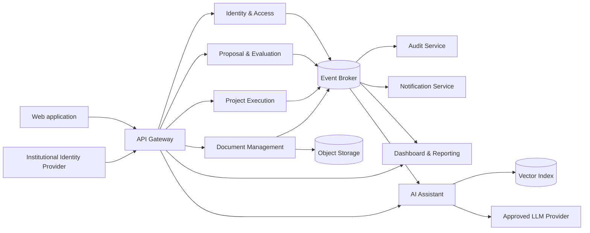
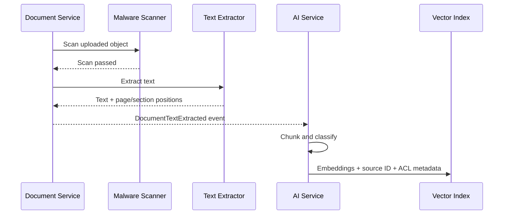

# Backend Architecture — Research Project Management Platform

## 1. Architectural direction

Use a small set of domain-oriented Spring Boot microservices behind a single API Gateway. Each service owns its data and exposes contracts through REST APIs and asynchronous domain events.

For the academic MVP, deploy the services together on one container host while preserving service boundaries. This avoids premature infrastructure complexity and still allows individual services to be scaled or deployed independently later.

### Recommended principles

- Domain-driven service boundaries; do not create one service per entity.
- Database ownership per service; no service reads another service's tables.
- Synchronous REST for operations that require an immediate result.
- Asynchronous events for notifications, dashboards, audit records, document processing, and AI indexing.
- OAuth 2.0 / OpenID Connect authentication with backend authorization on every protected operation.
- RBAC for institutional roles plus project-level membership and permissions.
- Immutable or append-only audit records for sensitive operations.
- Object storage for document bodies; relational databases store metadata and relationships.
- Retrieval-augmented generation (RAG) with authorization filtering before retrieval and before response generation.

## 2. System context



## 3. Service boundaries

### 3.1 API Gateway

Responsibilities:

- Single public backend entry point.
- Validate access tokens and reject unauthenticated traffic.
- Route requests, apply rate limits, correlation IDs, request-size limits, and CORS policy.
- Apply coarse-grained endpoint authorization; domain services remain responsible for final authorization.

Suggested implementation: Spring Cloud Gateway.

The gateway must not contain business workflows or become a shared business-logic layer.

### 3.2 Identity & Access Service

Responsibilities:

- Application user profile and account status.
- Institutional roles such as `ADMIN`, `COORDINATOR`, `RESEARCHER`, `EVALUATOR`, and `STUDENT`.
- Project memberships and project-scoped permissions, if not colocated with Project Execution.
- Authorization query/API used when a service needs current project access information.
- Role and permission change events.

Authentication should be delegated to an institutional OpenID Connect provider where possible. This service does not store institutional passwords.

Owned data: users, application roles, role assignments, account state, and optionally project permission grants.

### 3.3 Proposal & Evaluation Service

Responsibilities:

- Proposal drafts and submission.
- Proposal lifecycle and validated status transitions.
- Evaluator assignments.
- Evaluations, comments, recommendations, and decisions.
- Approval event that enables creation of a research project.

Owned data: proposals, proposal researchers, assignments, evaluations, decisions, and proposal status history.

Important events:

- `ProposalSubmitted`
- `EvaluatorAssigned`
- `EvaluationSubmitted`
- `ProposalApproved`
- `ProposalRejected`
- `ProposalChangesRequested`

### 3.4 Project Execution Service

Responsibilities:

- Convert an approved proposal into a project using an idempotent workflow.
- Project information, collaborators, status, and status transitions.
- Activities, assignments, milestones, deadlines, and evidence links.
- Consistent progress calculation.
- Final-report association, publications, and closure validation.

Owned data: projects, collaborators, activities, milestones, publication records, status history, and references to document IDs.

Important events:

- `ProjectCreated`
- `ProjectMemberChanged`
- `ActivityChanged`
- `MilestoneChanged`
- `DeadlineOverdue`
- `ProjectProgressChanged`
- `ProjectClosed`

### 3.5 Document Management Service

Responsibilities:

- Upload, download, version, and delete documents.
- Metadata, project/activity/milestone associations, content type, checksum, and confidentiality classification.
- Malware scanning and file validation before a document becomes available.
- Time-limited upload and download URLs after authorization.
- Text-extraction workflow for searchable and AI-authorized documents.

Owned data: document metadata, versions, storage keys, classification, checksums, processing state, and extraction state.

Binary content is stored in S3-compatible object storage such as MinIO. A bucket must not be publicly accessible.

Important events:

- `DocumentUploaded`
- `DocumentScanPassed`
- `DocumentTextExtracted`
- `DocumentAccessChanged`
- `DocumentDeleted`

### 3.6 Dashboard & Reporting Service

Responsibilities:

- Read-optimized dashboard models for coordinators and researchers.
- Upcoming and overdue items, project counts, progress summaries, and pending evaluations.
- Report generation and export jobs.

This service consumes domain events and builds projections. Its results are eventually consistent and must be filtered by the user's authorized project scope.

Owned data: denormalized read models, report jobs, and generated-report metadata.

### 3.7 AI Assistant Service

Responsibilities:

- Receive natural-language questions with authenticated user context.
- Resolve the user's authorized project/document scope through trusted backend data.
- Retrieve only chunks carrying matching access-control metadata.
- Apply a second authorization check to retrieved source IDs.
- Build grounded prompts, call an approved model, assess retrieval sufficiency, and return citations.
- Refuse unsupported answers and display the required informational disclaimer.
- Record privacy-conscious interaction metadata for audit and quality review.

Owned data: conversations if enabled, retrieval metadata, prompt/model configuration, response-source links, feedback, and limited audit metadata. Do not store full prompts or responses by default when they may contain confidential research data.

### 3.8 Audit Service

Responsibilities:

- Consume security and domain events.
- Store tamper-resistant audit entries containing actor, action, resource, timestamp, outcome, and correlation ID.
- Provide restricted search and export for authorized auditors.

Audit writes should not depend solely on client-provided fields. Sensitive document contents and AI prompt bodies should not be copied into audit records.

### 3.9 Notification Service

Responsibilities:

- Email and in-application notifications.
- Templates, user preferences, delivery retries, and delivery status.
- Deadline reminders and workflow notifications triggered by events.

This service is useful but may be deferred during the first MVP iteration if the UI alone presents deadlines and workflow state.

## 4. Data and storage

Use PostgreSQL as the transactional store. Each service owns a separate database or, for the MVP, a separate schema and database user. Cross-service foreign keys are forbidden; references to another domain are stored as identifiers and validated through contracts or events.

| Concern | Storage |
|---|---|
| Transactional domain data | PostgreSQL per service |
| Uploaded document bodies | Private S3-compatible object storage |
| Caching and short-lived distributed state | Redis, only when justified |
| Domain events | RabbitMQ for a simpler MVP, or Kafka for higher event volume/retention |
| AI semantic retrieval | PostgreSQL with pgvector for MVP |
| Logs, metrics, and traces | Central observability stack |

Use Flyway for schema migrations. Back up transactional databases, object storage, and configuration required for restoration. The vector index can be rebuilt from authorized source documents, but its rebuild procedure must be tested.

## 5. Communication and consistency

### Synchronous REST

Use REST when the caller needs an immediate decision or data response, for example:

- Validate whether the current user may update a project.
- Submit a proposal and receive the new status.
- Retrieve a project or download authorization.
- Ask the AI assistant a question.

Publish OpenAPI contracts for every externally consumed API. Use timeouts and bounded retries; do not retry non-idempotent requests without an idempotency key.

### Asynchronous events

Use events when the reaction may occur later or several consumers need the same fact, for example:

- Build dashboard projections after project changes.
- Index a document after scanning and text extraction.
- Create audit records and notifications.
- Detect approaching deadlines.

Use the transactional outbox pattern so a database change and its event cannot diverge. Consumers must be idempotent and store processed event IDs or otherwise tolerate duplicate delivery.

### Cross-service workflows

Avoid distributed database transactions. Use small sagas with compensating actions where needed.

Example: proposal approval to project creation:

1. Proposal service records approval and emits `ProposalApproved` through its outbox.
2. Project service consumes the event and creates one project using the proposal ID as an idempotency key.
3. Project service emits `ProjectCreated`.
4. Proposal and dashboard projections store the resulting project reference.

## 6. Authorization model

Authentication answers **who the user is**. Authorization answers **what that user may do to this specific resource**.

Use two layers:

1. Institutional RBAC determines capabilities such as assigning evaluators or closing projects.
2. Project-level access determines which proposal, project, evaluation, document, or AI source is visible to the user.

Every service must enforce authorization locally at the controller/use-case boundary and, where useful, at repository-query level. Never rely only on the UI or gateway. Resource queries should include authorized scope rather than retrieving broad data and filtering it afterward.

For sensitive operations, apply method-level authorization and explicit domain policies, for example:

```text
canEditProposal(user, proposal) =
  proposal.status in {DRAFT, CHANGES_REQUESTED}
  AND user is proposal owner or authorized collaborator
```

Service-to-service calls use workload credentials and never impersonate a user merely by accepting arbitrary user-ID headers. Forward a signed user token or exchange it for an audience-limited token when user context is required.

## 7. Secure RAG architecture

Recommended MVP approach: RAG with an external LLM API approved for institutional data, plus a configurable provider boundary. If policy prohibits sending confidential text externally, route confidential content to an approved local model or exclude it until suitable infrastructure exists.

### Ingestion flow



Each vector chunk should include at least: `documentId`, `projectId`, `classification`, allowed scope or policy version, document version, page/section, and source status.

### Question flow

1. Validate the user and AI entitlement.
2. Resolve current project and document permissions from trusted services/projections.
3. Search the vector index with mandatory authorization filters.
4. Revalidate the returned source IDs against current access data.
5. Apply a relevance/sufficiency threshold; if evidence is inadequate, say so.
6. Send only the minimum required authorized excerpts to the model.
7. Return the response with source references that the user can open.
8. Record operational metadata without unnecessarily retaining sensitive content.

Treat retrieved documents as untrusted input. Prompts must instruct the model not to follow instructions embedded in documents, and application code—not the model—must decide permissions and available tools.

## 8. Spring implementation baseline

Use a consistent service template:

- Java 21 as a conservative LTS baseline.
- Spring Boot 3.x.
- Spring Web MVC for ordinary CRUD and workflow APIs; WebFlux is optional for the gateway or streaming AI responses.
- Spring Security OAuth2 Resource Server.
- Spring Data JPA and PostgreSQL.
- Flyway migrations.
- Bean Validation.
- Spring Boot Actuator and Micrometer instrumentation.
- Springdoc/OpenAPI documentation.
- Testcontainers for integration tests.
- Resilience4j for explicit timeouts, circuit breakers, and limited retries where appropriate.

Suggested internal structure for each service:

```text
service/
  api/             REST controllers and request/response DTOs
  application/     use cases, commands, queries, transaction boundaries
  domain/          aggregates, value objects, policies, domain events
  infrastructure/  persistence, messaging, external clients, configuration
```

Domain models must not depend on controllers or persistence details. Do not expose JPA entities directly in APIs.

## 9. Deployment topology

### MVP

- Containerize each Spring Boot service.
- Deploy with Docker Compose or a simple institutional container platform.
- One PostgreSQL server with isolated schemas/users.
- MinIO or institution-approved S3 storage.
- RabbitMQ.
- One identity provider such as the institutional IdP or Keycloak for development.
- Reverse proxy/API Gateway with TLS.
- Central logs, basic metrics, health checks, and automated backups.

### Growth path

Move to Kubernetes only when operational needs justify it. At that point, add independent autoscaling, managed secrets, rolling deployments, network policies, and separate database instances for high-risk or high-load services.

## 10. MVP slicing

### Iteration 1 — Core workflow

- Authentication and roles.
- Proposal draft, submission, evaluation, and decision.
- Approved proposal conversion to project.
- Projects, collaborators, activities, milestones, and basic dashboards.
- Document upload/download with metadata and authorization.
- Audit trail for required actions.

### Iteration 2 — Monitoring and closure

- Deadline processing and notifications.
- Evidence, final reports, publications, and closure rules.
- Read-optimized coordinator and researcher dashboards.
- Report exports.

### Iteration 3 — Authorized AI assistant

- Text extraction and document indexing.
- Permission-filtered RAG.
- Citations, insufficiency behavior, disclaimers, and AI audit metadata.
- Security testing against cross-project leakage and prompt injection.

## 11. Testing strategy

- Unit tests for lifecycle transitions, progress calculation, closure policy, and authorization policies.
- Integration tests with PostgreSQL, object storage, and broker through Testcontainers.
- Contract tests for synchronous APIs and published events.
- End-to-end tests for proposal-to-project and project-closure workflows.
- Security tests for horizontal privilege escalation, document access, malicious files, and role changes.
- AI evaluation set covering groundedness, citation correctness, insufficient information, prompt injection, and cross-project data leakage.
- Restore tests for database and document backups.

## 12. Key architecture decisions to record

Create Architecture Decision Records (ADRs) for:

1. Service boundaries and why a limited number of services was selected.
2. Database-per-service ownership and MVP schema isolation.
3. RabbitMQ versus Kafka.
4. Object storage and malware-scanning approach.
5. Identity provider integration and project-level authorization.
6. External, local, or hybrid LLM processing by data classification.architecture
7. pgvector versus a dedicated vector database.
8. Audit retention and tamper-resistance policy.
9. Deployment with Compose versus Kubernetes.

## 13. Principal risks and controls

| Risk | Control |
|---|---|
| Too many services for a small team | Begin with the listed coarse-grained services; combine Audit/Notification operationally if necessary |
| Data inconsistency between services | Outbox pattern, idempotent consumers, explicit sagas, reconciliation jobs |
| Unauthorized AI disclosure | Pre-retrieval ACL filters, post-retrieval recheck, minimal context, leakage tests |
| Stale permissions in vector metadata | Permission-change events plus runtime source revalidation |
| Uploaded malware | Quarantine, scanning, MIME/signature validation, size limits |
| Shared database coupling | Separate ownership, credentials, migrations, and no cross-schema reads |
| Event contract changes | Versioned events, compatibility tests, consumer-driven contracts |
| Operational overload | Simple MVP deployment, standard service template, centralized observability |

