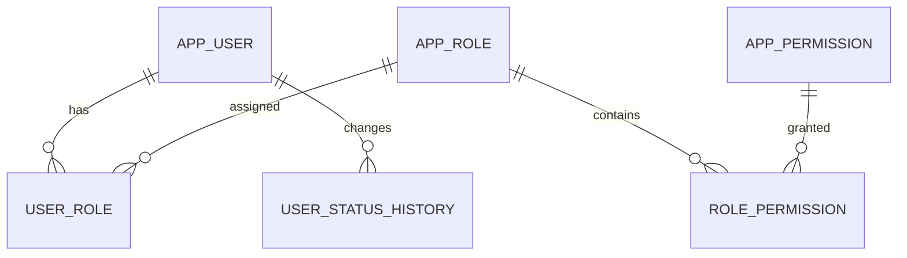
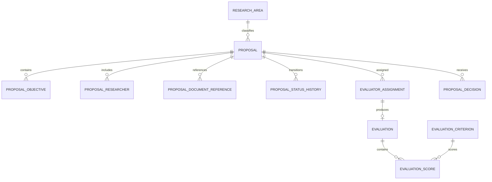
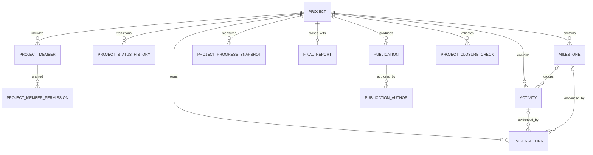
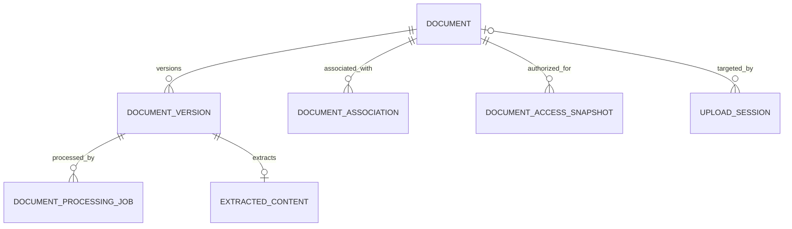
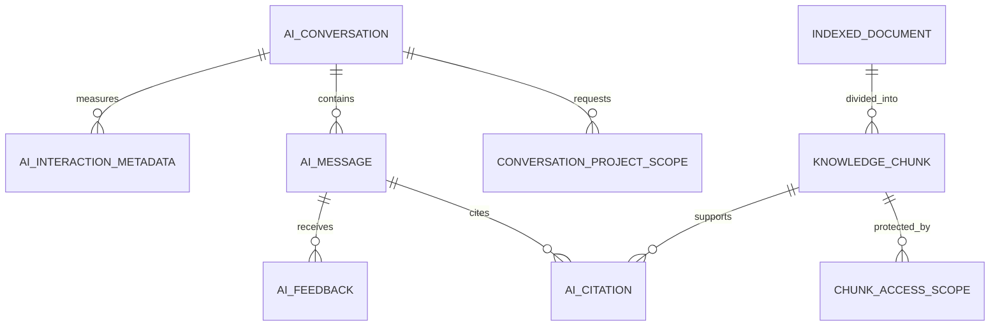

# Database Schema — Research Project Management Platform

This document defines the logical PostgreSQL schema for the microservices in `backend-architecture.md` and the resources exposed by `api-endpoints.md`.

## 1. Data ownership rules

Each microservice owns its database. For the MVP, one PostgreSQL cluster may host separate databases or schemas with separate database users, but ownership remains isolated.

| Service | Suggested database/schema | Ownership |
|---|---|---|
| Identity & Access | `identity_db` / `identity` | Users, roles, global permissions |
| Proposal & Evaluation | `proposal_db` / `proposal` | Proposals, evaluator assignments, evaluations |
| Project Execution | `project_db` / `project` | Projects, members, activities, milestones, closure |
| Document Management | `document_db` / `document` | Document metadata, versions, uploads, processing |
| Dashboard & Reporting | `reporting_db` / `reporting` | Read models and report jobs |
| AI Assistant | `ai_db` / `ai` | Conversations, messages, citations, vector index |
| Audit | `audit_db` / `audit` | Immutable audit trail |
| Notification | `notification_db` / `notification` | Notifications, preferences, deliveries |

Rules:

- A service may create foreign keys only between tables it owns.
- An identifier belonging to another service is stored as a plain UUID without a cross-database foreign key.
- External identifiers are validated through APIs, events, or local projections.
- No service may read another service's schema directly.
- Each transactional service publishes events with a transactional outbox.
- Event consumers must be idempotent and track processed message IDs.
- Database names and schema names may be adapted to the deployment platform; table ownership must not change.

## 2. Common conventions

### PostgreSQL types

| Purpose | Type |
|---|---|
| Internal/public identifier | `uuid` |
| Short code or enum-like value | `varchar(50)` with `CHECK`, or PostgreSQL enum only when change is rare |
| User-facing short name | `varchar(250)` |
| Long content | `text` |
| Timestamp | `timestamptz` stored in UTC |
| Calendar date | `date` |
| Version counter | `bigint` |
| Monetary/weighted numeric value | `numeric(p,s)` |
| Flexible provider metadata | `jsonb`, only when the structure is genuinely variable |
| Vector embedding | `vector(n)` supplied by `pgvector` |

### Standard mutable-table columns

Most mutable business tables include:

```text
id              uuid primary key
created_at      timestamptz not null
created_by      uuid not null
updated_at      timestamptz not null
updated_by      uuid not null
version         bigint not null default 0
```

`created_by` and `updated_by` are actor IDs from Identity & Access, stored without cross-service foreign keys. Hibernate `@Version` maps to `version` for optimistic locking.

Do not add `deleted_at` universally. Use soft deletion only when retention or restoration is required. Domain records such as submitted evaluations, closed projects, and audit events are retained rather than deleted.

### Naming

- Tables and columns use `snake_case`.
- Primary keys use `id`.
- Foreign keys use `<entity>_id`.
- Unique constraints use `uq_<table>_<columns>`.
- Foreign keys use `fk_<table>_<referenced_table>`.
- Indexes use `ix_<table>_<columns>`.
- Check constraints use `ck_<table>_<rule>`.

## 3. Identity & Access database

The institutional identity provider authenticates users. This database stores the application's user representation and authorization assignments, not passwords.

### `app_user`

| Column | Type | Rules |
|---|---|---|
| `id` | `uuid` | Primary key |
| `identity_subject` | `varchar(255)` | Not null; identity-provider `sub` claim |
| `institutional_id` | `varchar(100)` | Nullable; institution-issued identifier |
| `email` | `varchar(320)` | Not null; case-insensitive uniqueness recommended |
| `display_name` | `varchar(250)` | Not null |
| `given_name` | `varchar(150)` | Nullable |
| `family_name` | `varchar(150)` | Nullable |
| `status` | `varchar(30)` | `ACTIVE`, `DEACTIVATED`, `PENDING` |
| `locale` | `varchar(20)` | Nullable |
| `last_authenticated_at` | `timestamptz` | Nullable |
| standard audit columns | | Include optimistic version |

Constraints and indexes:

- Unique: `identity_subject`.
- Unique: normalized `email`.
- Unique when present: `institutional_id`.
- Index: `(status)` and trigram/search index on `display_name` if user search requires it.

### `app_role`

| Column | Type | Rules |
|---|---|---|
| `id` | `uuid` | Primary key |
| `code` | `varchar(50)` | Unique; e.g. `ADMIN`, `COORDINATOR` |
| `name` | `varchar(150)` | Not null |
| `description` | `text` | Nullable |
| `assignable` | `boolean` | Not null, default true |
| `active` | `boolean` | Not null, default true |
| standard audit columns | | |

### `app_permission`

| Column | Type | Rules |
|---|---|---|
| `id` | `uuid` | Primary key |
| `code` | `varchar(100)` | Unique; e.g. `proposal:evaluate` |
| `description` | `text` | Not null |
| `resource_type` | `varchar(50)` | Not null |
| `action` | `varchar(50)` | Not null |
| `active` | `boolean` | Not null, default true |

### `user_role`

| Column | Type | Rules |
|---|---|---|
| `user_id` | `uuid` | FK to `app_user` |
| `role_id` | `uuid` | FK to `app_role` |
| `assigned_at` | `timestamptz` | Not null |
| `assigned_by` | `uuid` | Not null |
| `reason` | `text` | Nullable |

Primary key: `(user_id, role_id)`.

### `role_permission`

| Column | Type | Rules |
|---|---|---|
| `role_id` | `uuid` | FK to `app_role` |
| `permission_id` | `uuid` | FK to `app_permission` |

Primary key: `(role_id, permission_id)`.

### `user_status_history`

| Column | Type | Rules |
|---|---|---|
| `id` | `uuid` | Primary key |
| `user_id` | `uuid` | FK to `app_user` |
| `previous_status` | `varchar(30)` | Nullable for initial state |
| `new_status` | `varchar(30)` | Not null |
| `reason` | `text` | Nullable |
| `changed_at` | `timestamptz` | Not null |
| `changed_by` | `uuid` | Not null |

Index: `(user_id, changed_at desc)`.

### Identity relationship diagram



## 4. Proposal & Evaluation database

### `research_area`

| Column | Type | Rules |
|---|---|---|
| `id` | `uuid` | Primary key |
| `code` | `varchar(50)` | Unique |
| `name` | `varchar(200)` | Not null |
| `description` | `text` | Nullable |
| `active` | `boolean` | Not null, default true |
| standard audit columns | | |

### `proposal`

| Column | Type | Rules |
|---|---|---|
| `id` | `uuid` | Primary key |
| `proposal_number` | `varchar(40)` | Unique, stable human-readable identifier |
| `title` | `varchar(500)` | Not null |
| `abstract_text` | `text` | Nullable while draft |
| `research_problem` | `text` | Nullable while draft |
| `methodology` | `text` | Nullable while draft |
| `expected_results` | `text` | Nullable while draft |
| `research_area_id` | `uuid` | Nullable while draft; FK to `research_area` |
| `estimated_duration_months` | `integer` | Positive when present |
| `status` | `varchar(30)` | Current proposal status |
| `owner_user_id` | `uuid` | External user ID, not null |
| `submitted_at` | `timestamptz` | Nullable until submitted |
| `submitted_by` | `uuid` | Nullable until submitted |
| `cancelled_at` | `timestamptz` | Nullable |
| standard audit columns | | |

Checks:

- `estimated_duration_months > 0` when present.
- Status in `DRAFT`, `SUBMITTED`, `UNDER_REVIEW`, `CHANGES_REQUESTED`, `APPROVED`, `REJECTED`, `CANCELLED`.
- Submission fields are populated when the status has moved beyond draft.

Indexes:

- `(owner_user_id, status)`.
- `(status, submitted_at)`.
- `(research_area_id, status)`.
- Full-text or trigram index for `title` if required.

### `proposal_objective`

| Column | Type | Rules |
|---|---|---|
| `id` | `uuid` | Primary key |
| `proposal_id` | `uuid` | FK to `proposal` |
| `objective_type` | `varchar(20)` | `GENERAL` or `SPECIFIC` |
| `description` | `text` | Not null |
| `display_order` | `integer` | Not null, nonnegative |
| standard audit columns | | |

Unique: `(proposal_id, display_order)`.

### `proposal_researcher`

| Column | Type | Rules |
|---|---|---|
| `proposal_id` | `uuid` | FK to `proposal` |
| `user_id` | `uuid` | External Identity user ID |
| `proposal_role` | `varchar(50)` | `PRINCIPAL`, `CO_RESEARCHER`, `STUDENT`, etc. |
| `responsibility` | `text` | Nullable |
| `added_at` | `timestamptz` | Not null |
| `added_by` | `uuid` | Not null |

Primary key: `(proposal_id, user_id)`.

Unique partial index: at most one `PRINCIPAL` researcher per proposal if institutional policy requires it.

### `proposal_document_reference`

This table stores references to Document Management records. It does not own file metadata.

| Column | Type | Rules |
|---|---|---|
| `id` | `uuid` | Primary key |
| `proposal_id` | `uuid` | FK to `proposal` |
| `document_id` | `uuid` | External Document Service ID |
| `purpose` | `varchar(50)` | `SUPPORTING`, `PROTOCOL`, etc. |
| `linked_at` | `timestamptz` | Not null |
| `linked_by` | `uuid` | Not null |

Unique: `(proposal_id, document_id, purpose)`.

### `proposal_status_history`

| Column | Type | Rules |
|---|---|---|
| `id` | `uuid` | Primary key |
| `proposal_id` | `uuid` | FK to `proposal` |
| `from_status` | `varchar(30)` | Nullable for creation |
| `to_status` | `varchar(30)` | Not null |
| `reason` | `text` | Nullable |
| `changed_at` | `timestamptz` | Not null |
| `changed_by` | `uuid` | Not null |
| `correlation_id` | `varchar(100)` | Nullable |

Index: `(proposal_id, changed_at desc)`.

### `evaluator_assignment`

| Column | Type | Rules |
|---|---|---|
| `id` | `uuid` | Primary key |
| `proposal_id` | `uuid` | FK to `proposal` |
| `evaluator_user_id` | `uuid` | External user ID |
| `status` | `varchar(30)` | `ASSIGNED`, `ACCEPTED`, `DECLINED`, `COMPLETED`, `REVOKED` |
| `assigned_at` | `timestamptz` | Not null |
| `assigned_by` | `uuid` | Not null |
| `due_date` | `date` | Nullable |
| `instructions` | `text` | Nullable |
| `completed_at` | `timestamptz` | Nullable |
| `revoked_at` | `timestamptz` | Nullable |
| `revoked_by` | `uuid` | Nullable |
| `revocation_reason` | `text` | Nullable |
| standard audit/version columns | | `created_by` may equal `assigned_by` |

Unique partial index: one active assignment per `(proposal_id, evaluator_user_id)`.

### `evaluation_criterion`

| Column | Type | Rules |
|---|---|---|
| `id` | `uuid` | Primary key |
| `code` | `varchar(50)` | Unique |
| `name` | `varchar(200)` | Not null |
| `description` | `text` | Not null |
| `minimum_score` | `numeric(6,2)` | Not null |
| `maximum_score` | `numeric(6,2)` | Not null |
| `weight` | `numeric(6,3)` | Positive |
| `active_from` | `date` | Not null |
| `active_until` | `date` | Nullable |
| standard audit columns | | |

### `evaluation`

| Column | Type | Rules |
|---|---|---|
| `id` | `uuid` | Primary key |
| `assignment_id` | `uuid` | Unique FK to `evaluator_assignment` |
| `proposal_id` | `uuid` | FK to `proposal`; duplicated for efficient scoped queries |
| `evaluator_user_id` | `uuid` | External user ID; immutable snapshot |
| `status` | `varchar(20)` | `DRAFT`, `SUBMITTED`, `RELEASED` |
| `observations` | `text` | Nullable |
| `recommendations` | `text` | Nullable |
| `decision` | `varchar(30)` | `APPROVE`, `REQUEST_CHANGES`, `REJECT`; nullable in draft |
| `total_score` | `numeric(8,2)` | Nullable/calculated |
| `submitted_at` | `timestamptz` | Nullable |
| `released_at` | `timestamptz` | Nullable |
| `released_by` | `uuid` | Nullable |
| standard audit columns | | |

Indexes: `(proposal_id, status)` and `(evaluator_user_id, status)`.

### `evaluation_score`

| Column | Type | Rules |
|---|---|---|
| `id` | `uuid` | Primary key |
| `evaluation_id` | `uuid` | FK to `evaluation` |
| `criterion_id` | `uuid` | FK to `evaluation_criterion` |
| `criterion_code_snapshot` | `varchar(50)` | Not null |
| `criterion_name_snapshot` | `varchar(200)` | Not null |
| `weight_snapshot` | `numeric(6,3)` | Not null |
| `score` | `numeric(6,2)` | Not null |
| `comment` | `text` | Nullable |
| standard audit columns | | |

Unique: `(evaluation_id, criterion_id)`.

The snapshot columns preserve the exact rubric used even if the catalog later changes.

### `proposal_decision`

Stores the formal coordinator decision separately from individual evaluator recommendations.

| Column | Type | Rules |
|---|---|---|
| `id` | `uuid` | Primary key |
| `proposal_id` | `uuid` | FK to `proposal` |
| `decision` | `varchar(30)` | `APPROVED`, `CHANGES_REQUESTED`, `REJECTED` |
| `rationale` | `text` | Nullable/required by policy |
| `decided_at` | `timestamptz` | Not null |
| `decided_by` | `uuid` | Not null |
| `supersedes_decision_id` | `uuid` | Nullable self-FK for authorized corrections |

Index: `(proposal_id, decided_at desc)`.

### Proposal relationship diagram



## 5. Project Execution database

### `project`

| Column | Type | Rules |
|---|---|---|
| `id` | `uuid` | Primary key |
| `project_number` | `varchar(40)` | Unique human-readable identifier |
| `source_proposal_id` | `uuid` | External Proposal Service ID; unique |
| `title` | `varchar(500)` | Not null; initial snapshot from proposal |
| `abstract_text` | `text` | Nullable |
| `research_area_code` | `varchar(50)` | Snapshot/reference code |
| `status` | `varchar(30)` | Current project status |
| `principal_researcher_id` | `uuid` | External user ID |
| `coordinator_user_id` | `uuid` | External user ID |
| `start_date` | `date` | Nullable before activation |
| `planned_end_date` | `date` | Not null |
| `actual_completion_date` | `date` | Nullable |
| `closure_date` | `date` | Nullable |
| `closed_by` | `uuid` | Nullable |
| `progress_percent` | `numeric(5,2)` | `0.00` through `100.00` |
| `progress_method` | `varchar(30)` | `ACTIVITY_WEIGHT`, `MILESTONE_WEIGHT`, etc. |
| standard audit columns | | |

Checks:

- `planned_end_date >= start_date` when start date is set.
- `progress_percent between 0 and 100`.
- Status in `APPROVED`, `ACTIVE`, `DELAYED`, `COMPLETED`, `CLOSED`, `CANCELLED`.

Indexes: `(status, planned_end_date)`, `(principal_researcher_id, status)`, `(coordinator_user_id, status)`.

### `project_member`

| Column | Type | Rules |
|---|---|---|
| `project_id` | `uuid` | FK to `project` |
| `user_id` | `uuid` | External Identity user ID |
| `project_role` | `varchar(50)` | `PRINCIPAL_RESEARCHER`, `RESEARCHER`, `STUDENT`, etc. |
| `status` | `varchar(20)` | `ACTIVE`, `REMOVED` |
| `joined_at` | `timestamptz` | Not null |
| `added_by` | `uuid` | Not null |
| `removed_at` | `timestamptz` | Nullable |
| `removed_by` | `uuid` | Nullable |

Primary key: `(project_id, user_id)`.

Index: `(user_id, status)` for “my projects” queries.

### `project_member_permission`

Use only for explicit project-level grants beyond the project role.

| Column | Type | Rules |
|---|---|---|
| `project_id` | `uuid` | With `user_id`, FK to `project_member` |
| `user_id` | `uuid` | With `project_id`, FK to `project_member` |
| `permission_code` | `varchar(100)` | e.g. `DOCUMENT_UPLOAD` |
| `granted_at` | `timestamptz` | Not null |
| `granted_by` | `uuid` | Not null |

Primary key: `(project_id, user_id, permission_code)`.

### `project_status_history`

| Column | Type | Rules |
|---|---|---|
| `id` | `uuid` | Primary key |
| `project_id` | `uuid` | FK to `project` |
| `from_status` | `varchar(30)` | Nullable |
| `to_status` | `varchar(30)` | Not null |
| `reason` | `text` | Nullable |
| `changed_at` | `timestamptz` | Not null |
| `changed_by` | `uuid` | Not null |
| `correlation_id` | `varchar(100)` | Nullable |

Index: `(project_id, changed_at desc)`.

### `milestone`

| Column | Type | Rules |
|---|---|---|
| `id` | `uuid` | Primary key |
| `project_id` | `uuid` | FK to `project` |
| `name` | `varchar(250)` | Not null |
| `description` | `text` | Nullable |
| `deadline` | `date` | Not null |
| `status` | `varchar(30)` | `PLANNED`, `IN_PROGRESS`, `COMPLETED`, `DELAYED`, `CANCELLED` |
| `weight` | `numeric(6,3)` | Nullable/positive |
| `completed_at` | `timestamptz` | Nullable |
| `display_order` | `integer` | Not null, nonnegative |
| standard audit columns | | |

Indexes: `(project_id, status)` and `(deadline, status)`.

### `activity`

| Column | Type | Rules |
|---|---|---|
| `id` | `uuid` | Primary key |
| `project_id` | `uuid` | FK to `project` |
| `milestone_id` | `uuid` | Nullable FK to `milestone` |
| `name` | `varchar(250)` | Not null |
| `description` | `text` | Nullable |
| `responsible_user_id` | `uuid` | External user ID |
| `start_date` | `date` | Not null |
| `deadline` | `date` | Not null |
| `status` | `varchar(30)` | `NOT_STARTED`, `IN_PROGRESS`, `BLOCKED`, `COMPLETED`, `CANCELLED` |
| `weight` | `numeric(6,3)` | Positive/default per calculation method |
| `completed_at` | `timestamptz` | Nullable |
| `block_reason` | `text` | Nullable |
| standard audit columns | | |

Checks: `deadline >= start_date` and `weight > 0`.

Indexes: `(project_id, status)`, `(milestone_id, status)`, `(responsible_user_id, status)`, `(deadline, status)`.

### `evidence_link`

| Column | Type | Rules |
|---|---|---|
| `id` | `uuid` | Primary key |
| `project_id` | `uuid` | FK to `project` |
| `activity_id` | `uuid` | Nullable FK to `activity` |
| `milestone_id` | `uuid` | Nullable FK to `milestone` |
| `document_id` | `uuid` | External Document Service ID |
| `description` | `text` | Nullable |
| `linked_at` | `timestamptz` | Not null |
| `linked_by` | `uuid` | Not null |

Check: at least one of `activity_id` or `milestone_id` is present. If policy requires exactly one, enforce XOR instead.

Unique indexes:

- `(activity_id, document_id)` when `activity_id is not null`.
- `(milestone_id, document_id)` when `milestone_id is not null`.

### `project_progress_snapshot`

Useful for historical reporting; the current percentage remains on `project`.

| Column | Type | Rules |
|---|---|---|
| `id` | `uuid` | Primary key |
| `project_id` | `uuid` | FK to `project` |
| `progress_percent` | `numeric(5,2)` | Not null |
| `calculation_method` | `varchar(30)` | Not null |
| `calculation_details` | `jsonb` | Structured contribution breakdown |
| `calculated_at` | `timestamptz` | Not null |
| `trigger_event_id` | `uuid` | Nullable |

Index: `(project_id, calculated_at desc)`.

### `final_report`

| Column | Type | Rules |
|---|---|---|
| `id` | `uuid` | Primary key |
| `project_id` | `uuid` | Unique FK to `project` |
| `document_id` | `uuid` | External Document Service ID |
| `status` | `varchar(20)` | `DRAFT`, `SUBMITTED`, `REOPENED` |
| `submitted_at` | `timestamptz` | Nullable |
| `submitted_by` | `uuid` | Nullable |
| `reopened_at` | `timestamptz` | Nullable |
| `reopened_by` | `uuid` | Nullable |
| `reopening_reason` | `text` | Nullable |
| standard audit columns | | |

### `publication`

| Column | Type | Rules |
|---|---|---|
| `id` | `uuid` | Primary key |
| `project_id` | `uuid` | FK to `project` |
| `title` | `varchar(500)` | Not null |
| `publication_type` | `varchar(50)` | Not null |
| `doi` | `varchar(255)` | Nullable |
| `publication_date` | `date` | Nullable |
| `url` | `text` | Nullable |
| `journal_or_venue` | `varchar(300)` | Nullable |
| `document_id` | `uuid` | Nullable external Document Service ID |
| standard audit columns | | |

Unique partial index on normalized DOI when present. Index: `(project_id, publication_date desc)`.

### `publication_author`

| Column | Type | Rules |
|---|---|---|
| `id` | `uuid` | Primary key |
| `publication_id` | `uuid` | FK to `publication` |
| `user_id` | `uuid` | Nullable external user ID |
| `display_name` | `varchar(250)` | Not null; supports external authors |
| `orcid` | `varchar(50)` | Nullable |
| `display_order` | `integer` | Not null |

Unique: `(publication_id, display_order)`.

### `project_closure_check`

Stores the evaluated closure conditions and their result.

| Column | Type | Rules |
|---|---|---|
| `id` | `uuid` | Primary key |
| `project_id` | `uuid` | FK to `project` |
| `condition_code` | `varchar(100)` | Not null |
| `satisfied` | `boolean` | Not null |
| `details` | `text` | Nullable |
| `checked_at` | `timestamptz` | Not null |
| `checked_by` | `uuid` | Nullable for automated checks |

Unique: `(project_id, condition_code)` for the current set. Use a separate history table if every assessment must be retained.

### Project relationship diagram



## 6. Document Management database

File bytes are stored in private object storage. Database records store metadata and opaque storage keys.

### `document`

| Column | Type | Rules |
|---|---|---|
| `id` | `uuid` | Primary key |
| `logical_name` | `varchar(500)` | Not null |
| `document_type` | `varchar(50)` | Not null |
| `classification` | `varchar(30)` | `PUBLIC`, `INTERNAL`, `CONFIDENTIAL`, `RESTRICTED` |
| `owner_user_id` | `uuid` | External Identity user ID |
| `current_version_number` | `integer` | Positive |
| `status` | `varchar(30)` | `PROCESSING`, `AVAILABLE`, `QUARANTINED`, `REJECTED`, `DELETED` |
| `deleted_at` | `timestamptz` | Nullable |
| `deleted_by` | `uuid` | Nullable |
| `deletion_reason` | `text` | Nullable |
| standard audit columns | | |

Indexes: `(owner_user_id, status)`, `(classification, status)`, and searchable `logical_name`.

### `document_version`

| Column | Type | Rules |
|---|---|---|
| `id` | `uuid` | Primary key |
| `document_id` | `uuid` | FK to `document` |
| `version_number` | `integer` | Positive |
| `original_file_name` | `varchar(500)` | Not null |
| `declared_content_type` | `varchar(150)` | Not null |
| `detected_content_type` | `varchar(150)` | Nullable until processed |
| `size_bytes` | `bigint` | Positive |
| `sha256` | `char(64)` | Not null |
| `storage_bucket` | `varchar(150)` | Not null |
| `storage_key` | `text` | Not null and opaque |
| `processing_status` | `varchar(30)` | `UPLOADED`, `SCANNING`, `EXTRACTING`, `READY`, `FAILED`, `INFECTED` |
| `uploaded_at` | `timestamptz` | Not null |
| `uploaded_by` | `uuid` | Not null |

Unique: `(document_id, version_number)`. Unique or indexed checksum according to deduplication policy. Never expose storage keys to clients.

### `document_association`

| Column | Type | Rules |
|---|---|---|
| `id` | `uuid` | Primary key |
| `document_id` | `uuid` | FK to `document` |
| `resource_type` | `varchar(30)` | `PROPOSAL`, `PROJECT`, `ACTIVITY`, `MILESTONE`, `FINAL_REPORT`, `PUBLICATION` |
| `resource_id` | `uuid` | External domain resource ID |
| `project_id` | `uuid` | Nullable external project scope; denormalized for authorization |
| `association_type` | `varchar(50)` | `SUPPORTING`, `EVIDENCE`, etc. |
| `created_at` | `timestamptz` | Not null |
| `created_by` | `uuid` | Not null |

Unique: `(document_id, resource_type, resource_id, association_type)`.

Indexes: `(resource_type, resource_id)` and `(project_id, document_id)`.

### `upload_session`

| Column | Type | Rules |
|---|---|---|
| `id` | `uuid` | Primary key |
| `initiated_by` | `uuid` | Not null |
| `target_document_id` | `uuid` | Nullable FK for new version |
| `declared_file_name` | `varchar(500)` | Not null |
| `declared_content_type` | `varchar(150)` | Not null |
| `declared_size_bytes` | `bigint` | Positive |
| `declared_sha256` | `char(64)` | Not null |
| `temporary_storage_key` | `text` | Not null |
| `status` | `varchar(30)` | `INITIALIZED`, `UPLOADED`, `COMPLETED`, `CANCELLED`, `EXPIRED` |
| `expires_at` | `timestamptz` | Not null |
| `completed_at` | `timestamptz` | Nullable |
| `created_at` | `timestamptz` | Not null |

Index: `(initiated_by, status)` and `(expires_at, status)` for cleanup.

### `document_processing_job`

| Column | Type | Rules |
|---|---|---|
| `id` | `uuid` | Primary key |
| `document_version_id` | `uuid` | FK to `document_version` |
| `job_type` | `varchar(30)` | `MALWARE_SCAN`, `MIME_DETECTION`, `TEXT_EXTRACTION`, `THUMBNAIL`, `AI_INDEX` |
| `status` | `varchar(20)` | `PENDING`, `RUNNING`, `SUCCEEDED`, `FAILED` |
| `attempt_count` | `integer` | Nonnegative |
| `next_attempt_at` | `timestamptz` | Nullable |
| `started_at` | `timestamptz` | Nullable |
| `completed_at` | `timestamptz` | Nullable |
| `failure_code` | `varchar(100)` | Nullable |
| `failure_detail` | `text` | Nullable and sanitized |
| `result_metadata` | `jsonb` | Nullable |

Unique: `(document_version_id, job_type)` for the current processing pipeline, or add an explicit run number for retained retries.

### `extracted_content`

| Column | Type | Rules |
|---|---|---|
| `id` | `uuid` | Primary key |
| `document_version_id` | `uuid` | Unique FK to `document_version` |
| `extractor_name` | `varchar(100)` | Not null |
| `extractor_version` | `varchar(50)` | Not null |
| `language_code` | `varchar(20)` | Nullable |
| `page_count` | `integer` | Nullable |
| `character_count` | `bigint` | Nonnegative |
| `content_storage_key` | `text` | Protected object-store key, not raw content |
| `extracted_at` | `timestamptz` | Not null |
| `content_sha256` | `char(64)` | Not null |

Store large extracted text in encrypted object storage rather than an unrestricted database text column.

### `document_access_snapshot`

Optional local authorization projection used to avoid synchronous authorization calls for every list query.

| Column | Type | Rules |
|---|---|---|
| `document_id` | `uuid` | FK to `document` |
| `subject_type` | `varchar(20)` | `USER`, `ROLE`, `PROJECT_MEMBER` |
| `subject_id` | `varchar(100)` | User UUID or stable role code |
| `permission` | `varchar(50)` | `READ`, `WRITE`, `DELETE`, `INDEX_FOR_AI` |
| `policy_version` | `varchar(100)` | Not null |
| `effective_from` | `timestamptz` | Not null |
| `effective_until` | `timestamptz` | Nullable |

Primary key: `(document_id, subject_type, subject_id, permission)`.

Runtime source validation remains required for AI responses even when this projection is used.

### Document relationship diagram



## 7. Dashboard & Reporting database

These are disposable/read-optimized projections rebuilt from domain events. They must still enforce authorized project scope.

### `project_summary_projection`

| Column | Type | Rules |
|---|---|---|
| `project_id` | `uuid` | Primary key; external Project ID |
| `project_number` | `varchar(40)` | Not null |
| `title` | `varchar(500)` | Not null |
| `research_area_code` | `varchar(50)` | Nullable |
| `status` | `varchar(30)` | Not null |
| `progress_percent` | `numeric(5,2)` | Not null |
| `principal_researcher_id` | `uuid` | Not null |
| `coordinator_user_id` | `uuid` | Not null |
| `planned_end_date` | `date` | Not null |
| `active_member_ids` | `uuid[]` | Acceptable for read projection; alternatively normalized membership projection |
| `updated_at` | `timestamptz` | Not null |
| `source_version` | `bigint` | Not null |

Indexes: `(status)`, `(coordinator_user_id, status)`, `(principal_researcher_id, status)`, GIN on `active_member_ids`, and `(planned_end_date)`.

### `deadline_projection`

| Column | Type | Rules |
|---|---|---|
| `resource_type` | `varchar(20)` | `ACTIVITY` or `MILESTONE` |
| `resource_id` | `uuid` | With type, primary key |
| `project_id` | `uuid` | Not null |
| `project_title` | `varchar(500)` | Not null |
| `resource_name` | `varchar(250)` | Not null |
| `responsible_user_id` | `uuid` | Nullable |
| `deadline` | `date` | Not null |
| `status` | `varchar(30)` | Not null |
| `deadline_state` | `varchar(20)` | `FUTURE`, `UPCOMING`, `OVERDUE`, `COMPLETED` |
| `updated_at` | `timestamptz` | Not null |

Primary key: `(resource_type, resource_id)`. Indexes: `(project_id, deadline)`, `(responsible_user_id, deadline_state)`, and `(deadline_state, deadline)`.

### `evaluation_summary_projection`

| Column | Type | Rules |
|---|---|---|
| `assignment_id` | `uuid` | Primary key |
| `proposal_id` | `uuid` | Not null |
| `proposal_title` | `varchar(500)` | Not null |
| `evaluator_user_id` | `uuid` | Not null |
| `assignment_status` | `varchar(30)` | Not null |
| `proposal_status` | `varchar(30)` | Not null |
| `due_date` | `date` | Nullable |
| `updated_at` | `timestamptz` | Not null |

Indexes: `(evaluator_user_id, assignment_status)` and `(proposal_status, due_date)`.

### `report_definition`

| Column | Type | Rules |
|---|---|---|
| `code` | `varchar(100)` | Primary key |
| `name` | `varchar(250)` | Not null |
| `description` | `text` | Nullable |
| `allowed_roles` | `varchar(50)[]` | Not null |
| `supported_formats` | `varchar(20)[]` | Not null |
| `parameter_schema` | `jsonb` | Validated JSON Schema |
| `active` | `boolean` | Not null |
| `version` | `integer` | Not null |

### `report_job`

| Column | Type | Rules |
|---|---|---|
| `id` | `uuid` | Primary key |
| `report_code` | `varchar(100)` | FK to `report_definition` |
| `requested_by` | `uuid` | Not null |
| `parameters` | `jsonb` | Not null; validated against definition |
| `format` | `varchar(20)` | Not null |
| `status` | `varchar(20)` | `QUEUED`, `RUNNING`, `COMPLETED`, `FAILED`, `CANCELLED`, `EXPIRED` |
| `output_storage_key` | `text` | Nullable and never returned directly |
| `requested_at` | `timestamptz` | Not null |
| `started_at` | `timestamptz` | Nullable |
| `completed_at` | `timestamptz` | Nullable |
| `expires_at` | `timestamptz` | Nullable |
| `failure_code` | `varchar(100)` | Nullable |
| `failure_detail` | `text` | Nullable and sanitized |

Indexes: `(requested_by, requested_at desc)` and `(status, requested_at)`.

## 8. AI Assistant database

Enable the `pgvector` extension. The embedding dimension must match the selected embedding model and be recorded with the index version.

### `ai_conversation`

| Column | Type | Rules |
|---|---|---|
| `id` | `uuid` | Primary key |
| `owner_user_id` | `uuid` | External user ID |
| `title` | `varchar(250)` | Not null |
| `include_institutional_knowledge` | `boolean` | Not null |
| `status` | `varchar(20)` | `ACTIVE`, `DELETED`, `EXPIRED` |
| `retention_until` | `timestamptz` | Nullable |
| standard audit columns | | |

Index: `(owner_user_id, updated_at desc)`.

### `conversation_project_scope`

Requested scope is never authoritative; it is intersected with current permissions for every question.

| Column | Type | Rules |
|---|---|---|
| `conversation_id` | `uuid` | FK to `ai_conversation` |
| `project_id` | `uuid` | External Project ID |
| `added_at` | `timestamptz` | Not null |

Primary key: `(conversation_id, project_id)`.

### `ai_message`

| Column | Type | Rules |
|---|---|---|
| `id` | `uuid` | Primary key |
| `conversation_id` | `uuid` | FK to `ai_conversation` |
| `role` | `varchar(20)` | `USER`, `ASSISTANT`, `SYSTEM_NOTICE` |
| `content_ciphertext` | `bytea` | Nullable if content retention is disabled; application-encrypted |
| `content_key_reference` | `varchar(255)` | Nullable key-management reference |
| `content_sha256` | `char(64)` | Nullable |
| `support_status` | `varchar(30)` | Nullable for user messages |
| `model_provider` | `varchar(100)` | Nullable |
| `model_name` | `varchar(100)` | Nullable |
| `prompt_template_version` | `varchar(50)` | Nullable |
| `created_at` | `timestamptz` | Not null |
| `created_by` | `uuid` | Not null |
| `retention_until` | `timestamptz` | Nullable |

Index: `(conversation_id, created_at)`.

If policy prohibits retaining prompts/responses, keep `content_ciphertext` null after delivery and retain only operational metadata.

### `ai_citation`

| Column | Type | Rules |
|---|---|---|
| `id` | `uuid` | Primary key and public source reference ID |
| `message_id` | `uuid` | FK to assistant `ai_message` |
| `document_id` | `uuid` | External Document ID |
| `document_version` | `integer` | Not null |
| `chunk_id` | `uuid` | FK to `knowledge_chunk` |
| `document_name_snapshot` | `varchar(500)` | Not null |
| `page_number` | `integer` | Nullable |
| `section_label` | `varchar(500)` | Nullable |
| `excerpt_ciphertext` | `bytea` | Nullable and application-encrypted |
| `display_order` | `integer` | Not null |
| `authorization_policy_version` | `varchar(100)` | Not null |

Unique: `(message_id, display_order)`.

### `indexed_document`

| Column | Type | Rules |
|---|---|---|
| `document_id` | `uuid` | With version, primary key; external ID |
| `document_version` | `integer` | With ID, primary key |
| `project_id` | `uuid` | Nullable external project scope |
| `classification` | `varchar(30)` | Not null |
| `document_name` | `varchar(500)` | Not null |
| `content_sha256` | `char(64)` | Not null |
| `embedding_model` | `varchar(100)` | Not null |
| `index_version` | `varchar(50)` | Not null |
| `access_policy_version` | `varchar(100)` | Not null |
| `status` | `varchar(20)` | `INDEXING`, `READY`, `STALE`, `REMOVED`, `FAILED` |
| `indexed_at` | `timestamptz` | Nullable |
| `updated_at` | `timestamptz` | Not null |

Indexes: `(project_id, status)` and `(status, updated_at)`.

### `knowledge_chunk`

| Column | Type | Rules |
|---|---|---|
| `id` | `uuid` | Primary key |
| `document_id` | `uuid` | With version, FK to `indexed_document` |
| `document_version` | `integer` | With ID, FK to `indexed_document` |
| `project_id` | `uuid` | Nullable/denormalized for mandatory ACL filters |
| `classification` | `varchar(30)` | Not null |
| `chunk_number` | `integer` | Not null |
| `page_from` | `integer` | Nullable |
| `page_to` | `integer` | Nullable |
| `section_label` | `varchar(500)` | Nullable |
| `content_ciphertext` | `bytea` | Application-encrypted authorized text |
| `content_for_search` | `text` | Only if database/storage security policy permits plaintext |
| `content_sha256` | `char(64)` | Not null |
| `token_count` | `integer` | Positive |
| `embedding` | `vector(n)` | Not null |
| `access_policy_version` | `varchar(100)` | Not null |
| `active` | `boolean` | Not null |
| `created_at` | `timestamptz` | Not null |

Unique: `(document_id, document_version, chunk_number)`.

Indexes:

- Vector index using HNSW or IVFFlat, chosen after representative testing.
- `(project_id, classification, active)` to apply authorization filters before similarity search.
- `(document_id, document_version, active)` for deletion/reindexing.

If embeddings themselves are considered sensitive, encrypt disks/backups and restrict database access because vector indexes cannot operate on application-encrypted embeddings.

### `chunk_access_scope`

Use this only when project/classification filtering is insufficient and explicit scopes are required.

| Column | Type | Rules |
|---|---|---|
| `chunk_id` | `uuid` | FK to `knowledge_chunk` |
| `scope_type` | `varchar(20)` | `PROJECT`, `ROLE`, `USER`, `INSTITUTION` |
| `scope_value` | `varchar(100)` | Stable project/user UUID or role code |
| `policy_version` | `varchar(100)` | Not null |

Primary key: `(chunk_id, scope_type, scope_value)`.

### `ai_feedback`

| Column | Type | Rules |
|---|---|---|
| `id` | `uuid` | Primary key |
| `message_id` | `uuid` | FK to assistant `ai_message` |
| `submitted_by` | `uuid` | Not null |
| `rating` | `varchar(30)` | `HELPFUL`, `NOT_HELPFUL` |
| `reason_codes` | `varchar(50)[]` | Nullable |
| `comment_ciphertext` | `bytea` | Nullable/encrypted |
| `submitted_at` | `timestamptz` | Not null |

Unique: `(message_id, submitted_by)` unless multiple feedback revisions are desired.

### `ai_interaction_metadata`

Privacy-conscious operational and audit metadata.

| Column | Type | Rules |
|---|---|---|
| `id` | `uuid` | Primary key |
| `conversation_id` | `uuid` | Nullable FK |
| `question_message_id` | `uuid` | Nullable FK |
| `response_message_id` | `uuid` | Nullable FK |
| `user_id` | `uuid` | Not null |
| `started_at` | `timestamptz` | Not null |
| `completed_at` | `timestamptz` | Nullable |
| `outcome` | `varchar(30)` | `SUPPORTED`, `INSUFFICIENT`, `DENIED`, `FAILED` |
| `retrieved_chunk_count` | `integer` | Nonnegative |
| `citation_count` | `integer` | Nonnegative |
| `input_token_count` | `integer` | Nullable |
| `output_token_count` | `integer` | Nullable |
| `latency_ms` | `integer` | Nullable |
| `correlation_id` | `varchar(100)` | Not null |
| `error_code` | `varchar(100)` | Nullable |

Do not place raw question or response content in this table.

### AI relationship diagram



## 9. Audit database

### `audit_event`

This table is append-only. The application role may insert and read according to authorization but may not update or delete.

| Column | Type | Rules |
|---|---|---|
| `id` | `uuid` | Primary key/event ID |
| `occurred_at` | `timestamptz` | Not null |
| `received_at` | `timestamptz` | Not null |
| `actor_type` | `varchar(20)` | `USER`, `SERVICE`, `SYSTEM` |
| `actor_id` | `varchar(255)` | Not null |
| `action` | `varchar(100)` | Not null |
| `resource_type` | `varchar(50)` | Not null |
| `resource_id` | `uuid` | Nullable |
| `project_id` | `uuid` | Nullable for scoped audit searches |
| `outcome` | `varchar(20)` | `SUCCESS`, `FAILURE`, `DENIED` |
| `correlation_id` | `varchar(100)` | Not null |
| `source_service` | `varchar(100)` | Not null |
| `source_ip_hash` | `varchar(255)` | Nullable; hash or store according to policy |
| `metadata` | `jsonb` | Sanitized, non-content metadata |
| `previous_hash` | `char(64)` | Nullable, if hash chaining is implemented |
| `event_hash` | `char(64)` | Nullable, if tamper-evident chaining is implemented |

Indexes:

- `(occurred_at desc)`.
- `(actor_id, occurred_at desc)`.
- `(resource_type, resource_id, occurred_at desc)`.
- `(project_id, occurred_at desc)`.
- `(correlation_id)`.
- Consider monthly range partitioning by `occurred_at` for retention and query performance.

### `audit_export_job`

| Column | Type | Rules |
|---|---|---|
| `id` | `uuid` | Primary key |
| `requested_by` | `uuid` | Not null |
| `filter_definition` | `jsonb` | Not null |
| `status` | `varchar(20)` | `QUEUED`, `RUNNING`, `COMPLETED`, `FAILED`, `EXPIRED` |
| `output_storage_key` | `text` | Nullable |
| `requested_at` | `timestamptz` | Not null |
| `completed_at` | `timestamptz` | Nullable |
| `expires_at` | `timestamptz` | Nullable |

## 10. Notification database

### `notification`

| Column | Type | Rules |
|---|---|---|
| `id` | `uuid` | Primary key |
| `recipient_user_id` | `uuid` | External Identity user ID |
| `notification_type` | `varchar(100)` | Not null |
| `title` | `varchar(250)` | Not null |
| `body` | `text` | Not null; must not contain unnecessary confidential content |
| `resource_type` | `varchar(50)` | Nullable |
| `resource_id` | `uuid` | Nullable |
| `project_id` | `uuid` | Nullable |
| `created_at` | `timestamptz` | Not null |
| `read_at` | `timestamptz` | Nullable |
| `expires_at` | `timestamptz` | Nullable |

Indexes: `(recipient_user_id, read_at, created_at desc)` and `(expires_at)`.

### `notification_preference`

| Column | Type | Rules |
|---|---|---|
| `user_id` | `uuid` | External user ID |
| `notification_type` | `varchar(100)` | Not null |
| `in_app_enabled` | `boolean` | Not null |
| `email_enabled` | `boolean` | Not null |
| `updated_at` | `timestamptz` | Not null |
| `updated_by` | `uuid` | Not null |

Primary key: `(user_id, notification_type)`.

### `notification_delivery`

| Column | Type | Rules |
|---|---|---|
| `id` | `uuid` | Primary key |
| `notification_id` | `uuid` | FK to `notification` |
| `channel` | `varchar(20)` | `IN_APP`, `EMAIL` |
| `status` | `varchar(20)` | `PENDING`, `SENT`, `FAILED`, `CANCELLED` |
| `provider_message_id` | `varchar(255)` | Nullable |
| `attempt_count` | `integer` | Nonnegative |
| `next_attempt_at` | `timestamptz` | Nullable |
| `sent_at` | `timestamptz` | Nullable |
| `failure_code` | `varchar(100)` | Nullable |
| `failure_detail` | `text` | Nullable and sanitized |

Unique: `(notification_id, channel)` unless repeated deliveries are intentionally retained as separate rows.

### `notification_template`

| Column | Type | Rules |
|---|---|---|
| `id` | `uuid` | Primary key |
| `template_code` | `varchar(100)` | Not null |
| `channel` | `varchar(20)` | Not null |
| `locale` | `varchar(20)` | Not null |
| `subject_template` | `text` | Nullable for in-app messages |
| `body_template` | `text` | Not null |
| `version_number` | `integer` | Positive |
| `active` | `boolean` | Not null |
| standard audit columns | | |

Unique: `(template_code, channel, locale, version_number)`.

## 11. Reliable messaging tables

Every service that writes business data and publishes events has an `outbox_event` table in its own database.

### `outbox_event`

| Column | Type | Rules |
|---|---|---|
| `id` | `uuid` | Primary key/event ID |
| `aggregate_type` | `varchar(100)` | Not null |
| `aggregate_id` | `uuid` | Not null |
| `event_type` | `varchar(150)` | Not null |
| `event_version` | `integer` | Not null |
| `payload` | `jsonb` | Not null; no unnecessary confidential content |
| `occurred_at` | `timestamptz` | Not null |
| `correlation_id` | `varchar(100)` | Nullable |
| `actor_id` | `varchar(255)` | Nullable |
| `published_at` | `timestamptz` | Nullable |
| `attempt_count` | `integer` | Not null, default 0 |
| `next_attempt_at` | `timestamptz` | Nullable |

Indexes: partial `(occurred_at)` where `published_at is null`, plus `(aggregate_type, aggregate_id)`.

Rows should be inserted in the same transaction as the domain update. A publisher sends them to RabbitMQ and marks `published_at` after broker confirmation.

### `processed_event`

Every event-consuming service has this table or an equivalent inbox mechanism.

| Column | Type | Rules |
|---|---|---|
| `event_id` | `uuid` | Primary key |
| `consumer_name` | `varchar(150)` | Not null |
| `event_type` | `varchar(150)` | Not null |
| `processed_at` | `timestamptz` | Not null |
| `result` | `varchar(20)` | `SUCCEEDED`, `IGNORED` |

If multiple consumers within one service process the same event independently, use primary key `(event_id, consumer_name)`.

## 12. Important deletion and foreign-key behavior

Recommended defaults:

| Relationship | Delete behavior |
|---|---|
| Proposal → objectives/researchers | `ON DELETE CASCADE` only while proposal is a deletable draft |
| Proposal → assignments/evaluations | `ON DELETE RESTRICT` after workflow begins |
| Project → activities/milestones | `ON DELETE RESTRICT`; projects are retained historically |
| Milestone → activity | `ON DELETE SET NULL` only if detaching is valid; otherwise `RESTRICT` |
| Document → versions | `ON DELETE RESTRICT`; use soft deletion |
| Evaluation → scores | `ON DELETE CASCADE` only for a draft evaluation; submitted evaluation is immutable |
| Conversation → messages | According to AI retention policy; deletion should be auditable |
| Audit event | Never cascaded or deleted by application users |

Enforce domain state before deletion in application logic; foreign keys are the final integrity boundary, not the entire policy.

## 13. Transaction boundaries

Transactions never span service databases.

Examples:

- Submitting a proposal updates `proposal`, appends `proposal_status_history`, and inserts `outbox_event` in one Proposal database transaction.
- Completing an activity updates `activity`, recalculates `project.progress_percent`, appends `project_progress_snapshot`, and inserts event rows in one Project database transaction.
- Completing an upload creates `document`/`document_version`, updates `upload_session`, creates processing jobs, and inserts an outbox event in one Document database transaction.
- Creating an AI answer inserts the assistant message, its citations, interaction metadata, and an outbox event in one AI database transaction, subject to the configured content-retention policy.

Cross-service results are completed with idempotent event handlers and reconciliation jobs, not distributed transactions.

## 14. Minimum MVP table set

If implementation time is constrained, start with these tables:

### Identity

`app_user`, `app_role`, `app_permission`, `user_role`, `role_permission`, `user_status_history`, `outbox_event`.

### Proposal

`research_area`, `proposal`, `proposal_objective`, `proposal_researcher`, `proposal_document_reference`, `proposal_status_history`, `evaluator_assignment`, `evaluation_criterion`, `evaluation`, `evaluation_score`, `proposal_decision`, `outbox_event`, `processed_event`.

### Project

`project`, `project_member`, `project_member_permission`, `project_status_history`, `milestone`, `activity`, `evidence_link`, `project_progress_snapshot`, `final_report`, `publication`, `publication_author`, `project_closure_check`, `outbox_event`, `processed_event`.

### Document

`document`, `document_version`, `document_association`, `upload_session`, `document_processing_job`, `extracted_content`, `document_access_snapshot`, `outbox_event`, `processed_event`.

### Reporting

`project_summary_projection`, `deadline_projection`, `evaluation_summary_projection`, `report_definition`, `report_job`, `processed_event`.

### AI

`ai_conversation`, `conversation_project_scope`, `ai_message`, `ai_citation`, `indexed_document`, `knowledge_chunk`, `chunk_access_scope`, `ai_feedback`, `ai_interaction_metadata`, `outbox_event`, `processed_event`.

### Audit and notification

`audit_event`, `audit_export_job`, `processed_event`, `notification`, `notification_preference`, `notification_delivery`, `notification_template`, `outbox_event`, `processed_event`.

## 15. Migration order

Within each database, create migrations in dependency order:

1. Extensions such as `pgcrypto`, `citext`, and `vector` where required.
2. Reference/catalog tables.
3. Aggregate-root tables.
4. Child and relationship tables.
5. History and projection tables.
6. Outbox/inbox tables.
7. Indexes that are not already created with constraints.
8. Restricted database roles, grants, append-only audit permissions, and row/column protections if used.

Use one Flyway history per service. A service must never run another service's migrations.

