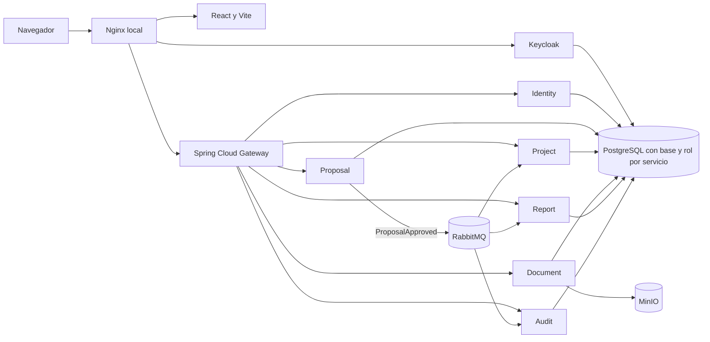

# InvestiTrack AI

InvestiTrack AI gestiona el ciclo de investigación académica. Una propuesta se redacta, envía y evalúa en la plataforma. Su aprobación registra un evento que genera el proyecto de forma asíncrona y con control de acceso por rol y membresía.

## Arranque local

Se necesita Docker Engine con Compose v2 y contenedores Linux, Python 3 para generar las credenciales y una conexión para la primera compilación. Asigna al motor unos 8 GB de RAM si compilas todos los servicios juntos. Los puertos TCP 8080 y 9000 deben estar libres en la máquina local.

Desde la raíz del clon:

```sh
python infra/init-env.py
docker compose config --quiet
docker compose up --build -d --wait
docker compose ps -a
```

Abre **http://localhost:8080**. Nginx publica la aplicación, `/api/v1` y los endpoints del realm de Keycloak en el mismo origen. El puerto **http://localhost:9000** sirve las URL prefirmadas de MinIO. Ambos puertos están ligados a la interfaz local. Usa `localhost` en el navegador para que la URL coincida con el emisor y el redirect registrado.

`docker compose up --build -d` inicia la misma infraestructura y devuelve el control en cuanto termina el arranque de los contenedores. `--wait` espera también sus comprobaciones de salud.

El generador crea `.env` una sola vez con credenciales aleatorias independientes. Consulta el archivo local para acceder con los usuarios de prueba. Las credenciales y los JWT quedan fuera de los logs del procedimiento.

| Cuenta en Keycloak | Rol en Identity | Variable de la contraseña |
| --- | --- | --- |
| `investigador` | RESEARCHER | `LOCAL_RESEARCHER_PASSWORD` |
| `coordinacion` | COORDINATOR | `LOCAL_COORDINATOR_PASSWORD` |
| `evaluador` | EVALUATOR | `LOCAL_EVALUATOR_PASSWORD` |
| `observador` | RESEARCHER sin membresía en el proyecto de prueba | `LOCAL_OBSERVER_PASSWORD` |
| `admin` | ADMIN | `LOCAL_ADMIN_PASSWORD` |

Keycloak importa el realm de `infra/keycloak`. Identity crea su administrador con un sujeto explícito y `identity-init` crea las demás cuentas mediante su API. El navegador usa Authorization Code con PKCE S256, renueva el acceso en memoria y cierra sesión en Keycloak. El cliente `investitrack-dev-cli` es exclusivo del entorno local y sirve al aprovisionamiento y al verificador HTTP.

## Flujo de demostración

1. Inicia sesión como `investigador`. Crea una propuesta, completa sus campos, guarda el borrador y pulsa **Enviar propuesta**.
2. Cierra sesión. Como `coordinacion`, entra en **Evaluaciones**, abre la propuesta, asigna a **Evaluador Local** e inicia la evaluación.
3. Como `evaluador`, abre la propuesta en **Evaluaciones**, llena los criterios y el dictamen, y pulsa **Enviar evaluación**.
4. Regresa como `coordinacion`, revisa el dictamen, indica el fin previsto y pulsa **Aprobar propuesta**.
5. Consulta **Proyectos** y abre el proyecto generado. La lista se actualiza cada cinco segundos. El propietario de la propuesta también puede consultar el proyecto desde su cuenta.

## Arquitectura actual



| Servicio | Puerto interno | Base y dependencias |
| --- | --- | --- |
| Nginx de entrada | 80 | Frontend, Gateway y Keycloak |
| Frontend | 80 | React, TypeScript y Vite |
| API Gateway | 8080, gestión 9090 | Keycloak y APIs de dominio |
| Identity | 8081 | `identity_db`, Keycloak y RabbitMQ |
| Proposal | 8082 | `proposal_db`, Identity, Document y RabbitMQ |
| Project | 8083 | `project_db`, Identity, Proposal, Document y RabbitMQ |
| Document | 8084 | `document_db`, MinIO, Identity, Project y RabbitMQ |
| Report | 8085 | `reporting_db`, Identity, Proposal, Project y RabbitMQ |
| Audit | 8087 | `audit_db`, Identity y RabbitMQ |
| PostgreSQL | 5432 | Volumen persistente y siete roles aislados |
| Keycloak | 8080 | `keycloak_db` |
| RabbitMQ | 5672, gestión 15672 | Volumen persistente, exchanges y colas durables |
| MinIO | 9000, consola 9001 | Volumen persistente y bucket inicializado por `minio-init` |

Compose crea sus redes y proporciona DNS interno. Las referencias entre servicios se configuran con URLs. El registro y descubrimiento dinámico queda pendiente. Los siete servicios Java usan Spring Boot y JDK 25 en sus Dockerfiles. Identity se compila con Gradle Wrapper y los demás con Maven. Cada servicio ejecuta sus migraciones Flyway sobre su base. El script de PostgreSQL crea el rol y la base durante la primera inicialización del volumen y retira el permiso de conexión de `PUBLIC`. Los servicios consumen datos ajenos mediante sus contratos HTTP y eventos.

RabbitMQ recibe `proposal.ProposalApproved.v1` en `invesctictrack.domain`. Proposal publica desde su outbox con confirmación, Project registra el inbox y consulta el snapshot aprobado con un JWT de cliente confidencial. Una restricción de unicidad por propuesta y el identificador del evento protegen contra duplicados. MinIO Community y `mc` se compilan desde etiquetas del código oficial porque los registros upstream rechazaron la descarga de las imágenes de Community.

## Configuración

| Variables | Uso |
| --- | --- |
| `POSTGRES_ADMIN_PASSWORD`, `*_DB_PASSWORD` | Administrador de PostgreSQL y credenciales independientes de dueño |
| `KC_BOOTSTRAP_ADMIN_*`, `LOCAL_*_PASSWORD` | Administrador inicial de Keycloak y cuentas ficticias de aplicación |
| `PROPOSAL_CLIENT_SECRET`, `PROJECT_CLIENT_SECRET` | Acceso interno de los servicios del flujo con client credentials |
| `RABBITMQ_DEFAULT_*`, `MINIO_ROOT_*` | Credenciales locales del broker y almacenamiento |
| `S3_BUCKET`, `S3_REGION`, `S3_PUBLIC_ENDPOINT` | Bucket `documents`, región `us-east-1` y origen local por defecto |
| `DISABLED_ROUTE_OWNERS`, `AI_SERVICE_URL`, `NOTIFICATION_SERVICE_URL` | `ai,notification` por defecto. Para activar un propietario cuando exista su servicio, indica su URL y retira su nombre de la lista. |
| `VITE_DEMO_MODE`, `VITE_API_URL` | El build integrado fija `false` y `/api/v1` |

Usa los [contratos](./Backend/.agents/service-contracts.md), la [matriz frontend/backend](./docs/matriz-integracion-frontend.md) y los `openapi.json` bajo `Backend/<servicio>/src/main/resources/`. En cada servicio, `/v3/api-docs` está reservado al acceso interno con alcance de monitoreo. Los Compose individuales mantienen sus propios ejemplos y configuración.

Para explorar la interfaz con datos ficticios fuera de Compose, ejecuta `npm ci` y `npm run dev` desde `front/` con Node.js 22.12 o superior y `VITE_DEMO_MODE=true` en `front/.env.local`.

## Pruebas, diagnósticos y parada

```sh
docker compose config --quiet
docker compose ps -a
docker compose logs --tail 100 keycloak identity-init proposal-service project-service
docker compose exec rabbitmq rabbitmqctl list_queues name messages_ready messages_unacknowledged
python infra/verify-workflow.py
npm --prefix front ci
npm --prefix front test
npm --prefix front exec -- playwright install chromium
npm --prefix front run test:e2e
docker compose stop
```

El verificador HTTP crea datos ficticios, inspecciona las migraciones, vuelve a publicar el evento observado y reinicia Proposal y Project para comprobar persistencia. La prueba de navegador usa las cuentas y el formulario de Keycloak. Hay evidencia y comandos en [la resolución](./RESOLUCION_FEEDBACK_PROFESOR.md).

- Si un servicio no pasa el health check, consulta sus logs y los del servicio del que depende con `docker compose logs --tail 100 <servicio>`. Los trabajos de inicialización exitosos quedan en `Exited (0)`.
- Si se cambian contraseñas con un volumen de PostgreSQL ya inicializado, coordina la rotación en PostgreSQL y Keycloak antes de reiniciar los clientes. El init de PostgreSQL se ejecuta solo en un volumen nuevo y Keycloak conserva los realms existentes.
- Si una propuesta aprobada aún no muestra un proyecto, revisa los logs, la publicación del outbox y la tabla `incoming_event` de `project_db`.
- `docker compose stop` conserva los contenedores y `docker compose down` retira contenedores y redes conservando los volúmenes nombrados.

## Alcance

La integración local cubre el perfil, el flujo de propuestas y evaluaciones, la creación automática y lectura de proyectos y la consulta de usuarios. Document, Report y Audit tienen servicios backend propios. Sus pantallas, trabajadores de documentos y credenciales delegadas para algunos procesos secundarios tienen integración pendiente. IA y notificaciones son servicios planificados y el Gateway responde `503 FEATURE_UNAVAILABLE` en sus rutas desactivadas. La [arquitectura objetivo](./Backend/.agents/backend-architecture.md) incluye módulos y trabajadores adicionales.
